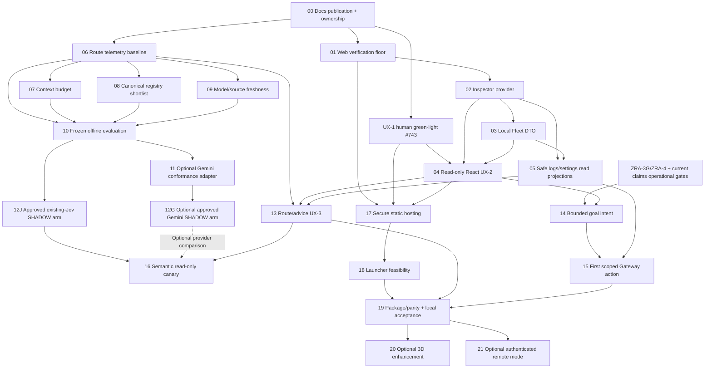

# Sunday Family Unified Dashboard + Intelligent Routing: Master Implementation Roadmap

วันที่: 2026-11-13 Asia/Bangkok (planning discovery เริ่ม 2026-11-12T21:53:50Z)
สถานะ: PROPOSED PROGRAM ROADMAP — NON-BINDING UNTIL PER-CARD WO ACCEPTANCE / NO PRODUCTION AUTHORITY GRANTED BY THIS DOCUMENT
Published by: `docs/work-orders/WO-P1-744-sfu26-roadmap-publication.md` (Issue: #744)
Authority repository: `aase7en/A-Wiki-Conductor`
Verified branch/base: `main@38fb5d5708d60049b9f50e2a377e526b667b0d07`
ประเภทงาน: R0 docs-only publication (card `CAND-SFU26-00`); ไม่เปลี่ยนสัญญา binding ใดๆ
Session inputs (untracked by design; sha256 digests recorded in WO-P1-744): task packet `docs/prompts/KILOCODE-SUNDAY-FAMILY-UNIFIED-DASHBOARD-ROADMAP-2026-11-13.md`, research archive `docs/research/2026-11-13-intelligent-routing-evidence-roadmap.md`

## 1. Executive Recommendation

**ข้อเสนอ:** ต่อโปรแกรม SundayFamily จาก React/TypeScript/Vite/PWA เดิม เป็น presentation เดียวเหนือ A-Sunday Conductor และ SunDayRemoteMCP ไม่เริ่ม dashboard, router, scheduler หรือ database ใหม่ ให้ส่งมอบ read-only truth ก่อน natural-language execution และ privileged settings

1. ปิด evidence/ownership gaps และขอ operator acceptance ของ UX-1 ที่มีแล้ว ไม่ออกแบบหน้าใหม่แข่งกับ mockup
2. ต่อ Inspector collectors และ Monitor projection ที่มีอยู่เข้ากับ production read provider; แยก Fleet จริงออกจาก session connector metadata
3. เพิ่ม route/context/usage telemetry และ freshness โดย reuse evidence seams เดิม แล้วลด context และ shortlist จาก A-Wiki แบบ deterministic ก่อนซื้อ decision inference
4. ใช้ `SemanticDecisionProvider` ที่มีแล้วสำหรับ fixture/shadow; Jev adapter มีอยู่ ไม่สร้าง SDP-1 ซ้ำ ส่วน Gemini เป็น optional adapter ภายหลัง schema/security/budget gates
5. ต่อ route explanation และ effective settings แบบอ่านอย่างเดียว; controls ทุกชนิดใช้ Command Gateway + authority/read-back จริง ไม่ใช้ HTTP `accepted` เป็นผลสำเร็จ
6. แพ็ก backend + web assets เป็นหนึ่งประสบการณ์; popup WebView เป็น candidate ตาม brief, PWA เป็น fallback, Tk ยังเป็น compatibility fallback จน parity/rollback ผ่าน

**ไม่สร้าง:** browser-owned task/claim store, provider/skill registry คู่ขนาน, general shell/SQL/path/prompt endpoint, direct browser-to-SRM mutation, another event bus, another review lifecycle, proprietary all-in-one orchestration framework หรือ 3D ที่เป็น dependency ของหน้าจอขั้นต่ำ

**เส้นทางขั้นต่ำ:** UX-1 acceptance + accepted read contracts -> live truth -> React read-only UX-2 -> secure same-origin hosting -> local operator acceptance. ไม่ต้องรอ Jev/Gemini, 3D, remote control หรือ automatic routing เพื่อใช้จออ่านสถานะได้

**เส้นทางโปรแกรมครบตาม vision:** ขั้นต่ำข้างต้น -> verified route/evidence views -> bounded goal intent + accepted execution fabric -> bounded actions -> packaging/parity. ห้ามเรียก read-only release ว่าทำ autonomous natural-language goal loop สำเร็จแล้ว

## 2. Evidence And Governance Snapshot

### 2.1 วิธีอ่านป้ายหลักฐาน

- `VERIFIED`: อ่าน source/file/Git/GitHub ณ exact revision หรือ URL/date ที่ระบุ; source verified ไม่ใช่ runtime verified
- `LIKELY`: ข้ออนุมานที่ยังต้องทดสอบ; ไม่ใช้เปิด mutation gate
- `ESTIMATE`: สมมติฐานสำหรับวางลำดับ/benchmark ไม่ใช่ผลวัด
- `UNKNOWN/UNVERIFIED`: ไม่มีหลักฐานพอ; แสดงตรงไปตรงมา ไม่แทนด้วยศูนย์หรือ READY
- `PROPOSED`: ทุก requirement, DTO extension, card, threshold และ milestone ในแผนนี้เป็นข้อเสนอจน integrator รับเข้า WO

### 2.2 Actual State ที่ตรวจแล้ว

| Evidence | VERIFIED ณ discovery | ข้อจำกัด/ผลต่อแผน |
|---|---|---|
| E01 Git identity | root `/Volumes/MAC_WORK/DevWorkspace/Github/A-Wiki-Conductor`; origin `https://github.com/aase7en/A-Wiki-Conductor.git`; local HEAD, `origin/main`, live `git ls-remote ... refs/heads/main` เท่ากันที่ `38fb5d5708d60049b9f50e2a377e526b667b0d07` | ไม่ fetch/pull/switch ระหว่าง planning; re-pin ก่อน WO ใหม่ |
| E02 Dirty baseline | tracked diff ว่าง; untracked `HUMAN_DECISION_REQUIRED`, task packet/research สองไฟล์ และ harness draft ใน `.kilo/plans/` | เป็น input ของผู้ใช้; ไม่แก้/ย้าย/commit/ignore ทิ้ง |
| E03 Current source CI | run `42850796151`, `completed/success`, exact main SHA E01 | เป็น CI ที่มีอยู่ ไม่ได้รันใหม่; ไม่พิสูจน์ deployed UI หรือ web tests ทั้งหมด |
| E04 Inspector delivery | PR #740 merge `9d084b560e652dccb6d3d5dac4e70d42c8a5d835`; post-main run `42610449527` success ที่ SHA นั้น; #739 checkpoint `6739429453` | slice 1 ส่งมอบแล้ว ไม่ใช่งาน parked ที่ต้องทำซ้ำ; live wiring ยังแยก |
| E05 UX-1 delivery | PR #742 head `e261537f0b7bb79931c89230437ea3032873bfe7`; candidate run `42846362540` success; merge E01/post-main E03; #743 checkpoint `6772884798` | เอกสาร/HTML merged แต่ operator green-light ยังไม่มีใน comments #739/#743 ที่อ่าน |
| E06 Old worktrees | Git metadata ยังมี 26 registrations; preserved WO739 branch `docs/wo739-inspector-projection@09a5ef046e0dc158e7aa6520e2dd787bf297f535`; WO738 `fix/wo738-sanitized-job-snapshot@1c29f1dbbc11739bd43d926506e06e69eab408e0` | registration/branch ไม่พิสูจน์ live writer หรือ inactivity; ไม่ cleanup และไม่ resume โดยอัตโนมัติ |
| E07 Remote open PR census | #723, #552, #335, #238, #222 เปิดอยู่ใน read-only census | PR age/closed parent ไม่ใช่ release claim; #552 lineage เกี่ยว claims ต้อง reconcile ไม่ steal scope |
| E08 Authority floor | `00-AGENT-ENTRY.md`, `AGENTS.md:9-23,47-59,84-93`, `PROJECT-GRAPH.yaml` execution_discipline, `FAST_EXECUTION_PROTOCOL.md` | no known owner/claim = SAFE_TO_MUTATE NO; default 3 mutable + 1 independent review รวมทุก repo |
| E09 #551 newer acceptance | comment `6743532865`, 2026-11-09T15:12:10Z, ยอมรับ upstream #58 contract และระบุว่าปลด acceptance/reconciliation blocker จาก #709 | ไม่แปลว่า mutable release/refill writer, C1-C3 operational evidence หรือ dispatch พร้อมแล้ว |
| E10 ZRA frontier | #736 body + closeout `6720403680`: prepared-run reconstruction ส่งมอบแล้ว แต่ ZRA-3G/ZRA-4 integrated acceptance ยังไม่ครบ | ไม่มี durable browser goal command ที่พิสูจน์ end-to-end; ODP expansion ไม่แย่ง P0 capacity |

GitHub references: [main CI](https://github.com/aase7en/A-Wiki-Conductor/actions/runs/42850796151), [Inspector checkpoint](https://github.com/aase7en/A-Wiki-Conductor/issues/739#issuecomment-6739429453), [UX-1 checkpoint](https://github.com/aase7en/A-Wiki-Conductor/issues/743#issuecomment-6772884798), [claim-contract acceptance](https://github.com/aase7en/A-Wiki-Conductor/issues/551#issuecomment-6743532865), [ZRA frontier](https://github.com/aase7en/A-Wiki-Conductor/issues/736).

### 2.3 Permission/Ownership Disposition

VERIFIED (planning session): discovery ทำแบบอ่านอย่างเดียว (ไฟล์/Git/GitHub/public documentation) ไม่มี mutating command; compound Git inspection บางรูปโดน permission gate ปฏิเสธ จึงใช้ permitted read-only commands + Git metadata โดยไม่ข้าม permission ผ่าน subprocess

ยังไม่มี active WO/claim ของ planning publication นี้ และไม่ได้พิสูจน์ live lease/session census ครบทุกเครื่อง จึง **ไม่อ้างว่า lane ทั้ง repo ว่าง** และไม่สร้าง issue/claim/worktree ปลอม

เอกสารฉบับนี้คือผลส่งมอบของ card `CAND-SFU26-00` เผยแพร่ผ่าน WO-P1-744 (Issue #744) ใน isolated docs-only lane จาก harness-local draft ซึ่งไม่ใช่ authority ในตัวเอง รอบ publication นี้ห้ามเขียน `CURRENT-WORK.md`, `handoff.md`, `AGENTS.md`, `PROJECT-GRAPH.yaml` หรือ UX-1 เดิม — shared-continuity fold เป็นของ integrator เมื่อ merge

GLM_OFFLOAD = BLOCKED สำหรับ external provider dispatch: planning-only/no paid API authorization; ไม่มี quota probe, Jev/Gemini/model inference request, runtime activation, deploy หรือ CI trigger. Read-only internal research helpers ไม่เป็น mutable lanes และผลเป็น advisory evidence เท่านั้น

### 2.4 Continuity Reconciliation ที่ห้ามตีความตาม summary เก่า

| ข้อความเก่า | หลักฐานใหม่/actual truth | การจัดการ |
|---|---|---|
| WO739 parked ยังไม่ merge | E04 ยืนยันอีก lane ส่ง Inspector slice 1 แล้ว | เก็บ old branch เป็นประวัติ ไม่เปิด redaction repair ซ้ำ |
| AGENTS repo-map ยัง uncommitted | `git log`: PR #741 merge `16b897a`, author `055b4f2`; actual tracked diff ว่าง | ไม่ทำ `/init` ซ้ำและไม่ rewrite entry contract |
| UX-1 ยังรอ PR/CI | E05 ผ่าน delivery แล้ว | ยังรอ operator review; unchecked WO boxes เป็น author-era snapshot |
| upstream #58 ยังไม่รับ contract | E09 รับแล้ว | แยก policy acceptance ออกจาก reader/history/ownership/writer acceptance |
| SF-WEB-0..7 ใน roadmap คือยังไม่สร้างทั้งหมด | source/WOs แสดง scaffold และหลาย PR merged แล้ว | inventory ใหม่ด้านล่างแยก source, wiring, runtime และ acceptance |

## 3. As-Is Feature And Authority Map

ทุก source anchor ในตารางนี้อ้าง AWC@E01; อ่าน source เท่านั้น ไม่รัน service/test ในรอบนี้

| Feature | สถานะที่ตรงกับหลักฐาน | Anchor / owner | สิ่งที่ยังขาด |
|---|---|---|---|
| Entry/policy and ownership contracts | EXISTING_AND_VERIFIED (เอกสาร) | entry/graph/AGENTS; `docs/contracts/a-wiki-a-conductor-integration.md:109-133` | runtime live claim census UNKNOWN |
| React/TS/Vite shell | IMPLEMENTED_NOT_RUNTIME_VERIFIED | `web/sunday-family/src/App.tsx:1-46`, `api.ts:1-186`, `TokenGate.tsx:5-42` | Thai IA/UX-2, production serving, real client acceptance |
| Authenticated API and SSE | IMPLEMENTED_NOT_RUNTIME_VERIFIED | `web_api.py:261-350,541-616`; `web_api_auth.py:26-71`; `api.ts:147-181` | actual Mac/Windows deployed version UNKNOWN |
| Cockpit lanes | PARTIAL | `web_api.py:119-172,499-525`; `desktop_control.py:132-198` | client does not receive every repo/HEAD/claim fact; missing fields stay UNKNOWN |
| Monitor/Inspector | PARTIAL | `monitor_projection.py:227-242`; `inspector_sources.py:63-264`; `inspector_projection.py:254-288` | no production source consumers; snapshot `web_api.py:166` ยัง hard-code MONITOR_PROJECTION_UNAVAILABLE |
| Legacy Monitor HTML | IMPLEMENTED_NOT_RUNTIME_VERIFIED | `monitor_page.py:12-228`; `monitor_api.py:207-217` | legacy page server ไม่ได้เปิดจาก production web entrypoint; retain compatibility, ไม่ทำ dashboard อีกตัว |
| Fleet Windows/Mac | DOC_ONLY / BLOCKED_BY_SOURCE | UX-1 design `:68,100-111`; session connectors `web_api.py:448-455` | accepted cross-device DTO + provenance/transport evidence; local collector ไม่เห็นอีกเครื่องโดยอัตโนมัติ |
| Worker/connector CRUD | PARTIAL | `web_api.py:387-494`; `ConnectorsPanel.tsx:26`; WO698 `:44-50` | เป็น in-memory app-session metadata ไม่ใช่ persisted Tk/runtime registry |
| Worker command | PARTIAL / EXECUTION_UNWIRED | `web_api.py:365-384`; `command_gateway.py:284-388` | HTTP accepts/audits เท่านั้น; no Gateway/runtime consumer; ห้าม green success |
| Claim consumption | PARTIAL | `awiki_claim_reader.py`; E09; integration contract `:115-129` | web DTO ไม่ได้ต่อ reader; no new browser claim store |
| Metrics | IMPLEMENTED_NOT_RUNTIME_VERIFIED | `web_api.py:307-314`; `system_metrics.py:24-30`; `MetricsPanel.tsx` | null = unavailable; no historical performance claim |
| Activity, tool usage, route costs | DOC_ONLY / no web DTO | `web_api.py:119-172`; UX-1 audit W2/W3 | safe event/log/cost projection ต้องเพิ่ม; inventory count ไม่ใช่ call usage |
| PWA static-only shell | IMPLEMENTED_NOT_RUNTIME_VERIFIED | `public/sw.js`, `src/pwa.ts:1-9`, `pwa-build.ts`; WO693 `:18-46` | installed/offline/browser acceptance ยังไม่พิสูจน์ |
| Production static hosting | BLOCKED / absent | ไม่มี StaticFiles/root UI route ใน `web_api.py`; build scripts ไม่อ้าง web bundle | same-origin assets/CSP/traversal/cache/auth gate ก่อน local distribution |
| Natural-language goal entry | DOC_ONLY / absent web endpoint | E10; `web_api.py`; UX-1 design `:27-34` | bounded intent contract + Graph/Command admission + ZRA front door |
| Semantic provider seam | EXISTING_AND_VERIFIED (source), runtime UNWIRED | WO502 `:31-69`, WO505 `:27-77`, `semantic_decision.py:74-90`, `semantic_admission.py:50-58,118` | ไม่มี execution/web/orchestration consumers ของ accepted provider chain; no interface ใหม่; comparison/Thai thresholds/family admission ยังต้อง evidence |
| Kilo hook visibility | DOC_ONLY runtime adapter | `docs/contracts/kilo-hook-adapter-v1.md:12-17,98-119,316-336` | offline conformance ไม่ใช่ live hook telemetry; native version 7.7.x pin ต้อง re-prove ถ้าเปลี่ยน |
| Mission Control | PARTIAL projection / 3D DOC_ONLY | `2026-09-24-mission-control-agent-digital-twin.md:227-285` | ใช้ lanes/waits/evidence เดิม; 3D optional P2 |
| Packaging and Tk parity | PARTIAL | WO697 `:8-20`; WO698 `:41-50,94-101`; runtime boundary `:112-117` | service config มีแล้วแต่ไม่ใช่ install proof; Tk-only capability/rollback ยังไม่ครบ |
| Frontend verification | PARTIAL | 7 test files + fixtures/setup ใต้ `web/sunday-family/tests/`; `.github/workflows/ci.yml`; `tests/test_web_api.py:94,275` | ไม่มี npm/Vitest CI job; 2 unconditional policy/headless skips ต้อง reconcile |

VERIFIED security nuance: API ใช้ hmac bearer, exact Host/Origin/duplicate-header gates, no-store และ bounded transport; `X-Confirm` เป็น client nonce ไม่ใช่ proof ของ claim/version หรือ complete CSRF authorization protocol. Legacy HTML มี CSP แต่ React production serving/CSP ยังไม่เกิด. Dev proxy allowlist ปัจจุบันไม่ได้เปิด arbitrary mutation; ต้องรักษาข้อนี้ ไม่แก้ให้ permissive เพื่อให้ demo ผ่าน

### 3.1 Single-Owner Map

| Capability | Owner | Consumer/adapter | ข้อห้าม |
|---|---|---|---|
| Skill/policy/knowledge, model intelligence, WO/review conventions | A-Wiki | AWC reads versioned source | no copied skill table/model-policy database |
| Durable repo coordination claim | canonical A-Wiki authority | AWC strict reader/admission adapter | ไม่ถือ local TTL cache เป็น peer claim authority |
| Runtime TaskGraph, attempts, leases, provider admission, replay, receipts | A-Sunday Conductor | UI/ODP/SRM evidence | browser/SRM ไม่ประกาศ accepted task truth |
| Physical execution, bounded tool capability, immutable collect | SunDayRemoteMCP | AWC reconciliation | no browser direct mutation, no SRM scheduler/control plane |
| Route workflow binding | A-FastTask + A-Faster overlay ตาม accepted policy | ODP applies eligibility | semantic output ไม่ override deterministic gates |
| Semantic recommendation | provider-neutral seam, untrusted advice | deterministic policy/integrator | no model grants mutation/review/merge/completion |
| UI/read model | SundayFamily React/PWA | Monitor/API/SSE | no durable offline truth/action queue |
| Independent review lifecycle | A-Wiki ReviewBus contract | AWC exact-artifact bridge | ไม่เพิ่ม review database หรือใช้ author self-PASS |

### 3.2 Upstream Reuse Gate

Planning disposition: READ_ONLY_COMPARISON; local upstream state, remote drift, live claims และ reusable routing/context anchors ต้องถูกใส่ใน freeze evidence ก่อน official implementation claim. หากอ่าน authoritative upstream ไม่ได้ให้ UNKNOWN และ block เฉพาะ upstream-dependent mutation; ไม่ถือ stale local checkout เป็น current A-Wiki

ใช้ A-Wiki `skills-registry.json`, `scripts/skills_registry/routing.py`, `skill_route`, hook registry, model policy/scout และ FTS5 เป็น canonical inputs. SRM เป็น substrate ไม่ใช่ทางลัดเข้าถึงอีกเครื่องจาก browser. Cross-repo changes ไม่ได้รับอนุญาตในรอบนี้

| Repository | Local observed identity | Remote/ownership evidence | Disposition |
|---|---|---|---|
| A-Wiki | `/Volumes/MAC_WORK/DevWorkspace/Github/_from_Desktop/A-Wiki@25102e44950ccd28c2d22eafc6e6f1d2119f18ad`; four existing modified `.kilo/agents/*.md` | live remote main `95074b3868800ccda1c6dc03d12bcb5564efd002`; drift confirmed, ancestor/direction UNKNOWN because permission limited history checks; #76 SKILL-ECO and #60 A-FastTask authority OPEN; open PRs #69/#68/#65/#59 | preserve dirt; no claim that clone is current; canonical routing/API compatibility must be re-proved at remote SHA before consumer changes |
| SunDayRemoteMCP | `/Volumes/MAC_WORK/DevWorkspace/Github/SunDayRemoteMCP@06265f7af67af56c5ffb653edb262c0639cd8677`, clean source checkout | remote main query denied; remote/deployed SHA UNKNOWN | local source references only, not deployed Windows/Mac proof; no cross-repo mutation/pin without fresh remote evidence |

VERIFIED local reuse anchors at the A-Wiki SHA above: `scripts/skills_registry/routing.py:1-317` defines the single matcher, consumed by `scripts/hooks/check_a_route.py`, MCP `skill_route` at `scripts/lib/neural_spine_mcp.py:656-673`, and generated `wiki/A-ROUTER.md`. `scripts/hooks/registry.py:67+` owns hard/soft hook classification. Do not translate hard/soft into invented OBSERVE/GUARD categories. `scripts/live-dashboard/skills_service.py:25` already consumes registry data; reuse its contracts where compatible rather than build another registry UI service

Local model/retrieval freshness observations: `.tmp/model-scout-current.json` mtime Jun12, model-catalog Jun29, capability-cache Jun15, router-policy Aug20; `wiki/context/model-roster.conf` and `.wiki-index.db` Sep10; `skills-registry.json` Sep16. These old mtimes are **currency warnings, not proof of semantic freshness or current remote content**. Registry exceeds the current Inspector default7-day bound. Vector code exists (`scripts/build-vec-index.py`, `scripts/wiki/query-rag.py`), but vector table presence/quality UNKNOWN because sqlite inspection was denied. Do not rebuild indexes or refresh scout in this planning task

`scripts/model-router-policy.py`, `scripts/model_match.py:33-45`, `scripts/choose-model.py`, `scripts/model-scout-current.py` and `scripts/model-capability-scout.py` are reuse candidates, not license to create another model policy engine. The local `.tmp/agent-claims.json` contains seven expired test-mirror cache rows, which says **nothing about current canonical durable claims or remote live writers**. Durable claims remain UNKNOWN until canonical reader/history/owner reconciliation; cached-empty must never unlock a new writer

Mac configuration gap: `inspector_sources.py:200-203` defaults the skill source to Windows `A:\GitHub\A-Wiki`; card02 must inject the approved Mac source root (and preserve Windows operation) without searching secret/user roots. `EvidencePack` is **not an existing named module**: it is a proposed derived packet extension, not a new retrieval/memory database

Terminology: a **job/attempt** is existing AWC durable execution identity; **workflow phase** is A-Wiki focus/process policy; **repo claim** is canonical coordination ownership, distinct from AWC runtime WorkerLease. **Browser session**, **backend service boot/session token**, **worker/provider session** and **cross-device transport session** are different lifetimes. **State** is qualified as authoritative job state, observed transport/health, derived liveness, UI presentation, or verification gate. A provider billing account is an externally approved payer, not a new app tenant/auth role

## 4. To-Be Architecture And Data Flow

PROPOSED: เปลี่ยนการต่อข้อมูล/presentation ไม่เปลี่ยนผู้มีอำนาจ

```text
A-Wiki: registry / policy / retrieval / model intelligence @ source revision
         |
         v
Existing A-FastTask / ODP packet + deterministic candidate eligibility
         |                         |
         |                    optional SemanticDecisionProvider
         |                    OFF / SHADOW / admitted ADVISORY
         |                         | untrusted bounded answer
         +------------> deterministic policy / Graph Admission
                                    |
                            AWC TaskGraph / leases / provider admission
                                    |
                             existing execution adapters -> SRM/worker
                                    |
                            immutable execution evidence
                                    v
                      AWC reconcile / verify / accepted receipt
                                    |
         Hook/STM + inspector collectors + existing evidence read ports
                                    v
                  sanitized bounded Monitor/public DTO projection
                                    |
                       authenticated API snapshots + SSE
                                    v
                       one React/PWA SundayFamily shell

Future typed operator intent/approval:
React -> AWC Command Gateway -> exact identity/claim/version/replay gates
      -> admitted existing backend action -> evidence -> verified read-back
```

### 4.1 DTO/Module Ownership, Not New Stores

| View/extension | Reuse seam | Contract required before exposure |
|---|---|---|
| Inspector view + collector notes | `build_inspector_views` -> `build_monitor_views` -> `public_snapshot` | version, per-device source/observed-at, code-only notes, 128 retained rows/group, dropped/truncated, existing redaction bounds |
| Fleet observation | accepted instance/transport observations | stable non-secret device identity, OS/source revision, transport vs capability readiness, expiry, no tunnel identifiers; absent remote source UNKNOWN |
| Work & Lanes identity | Cockpit + strict claim reader + TaskGraph | public display handles for repo/worktree/HEAD/claim and provenance; missing join never fabricated |
| Route explanation | existing provider selection/evidence + ODP packet | route/attempt identity, eligible candidates + exclusion codes, policy/registry revisions, context digest, source freshness; no hidden reasoning transcript |
| Usage/cost | accepted execution/tool/provider evidence | attempt dedup, measured usage/window, observed/estimated/unknown cost, verification receipt; no telemetry-owned job state |
| Settings effective view | accepted server configuration/policy | read-only effective values, source/scope/version, safe directory aliases; no key/secret-root listing |
| Logs/activity/replay | existing Hook/STM + durable event evidence | bounded sanitized records/cursors, ordering/source disclosure, redacted evidence refs, no arbitrary file-tail endpoint |
| Optional semantic answer | `SemanticDecisionRequest` / `SemanticEvidence` / `SemanticDecisionProvider` | existing typed errors/usage/model pin; no new DecisionRequest/Answer hierarchy parallel to accepted core |

เลือก snapshot child view ก่อนเพิ่ม endpoint ซ้ำ ถ้า child WO ต้องใช้ dedicated GET ให้กำหนด exact route/schema/auth/version ใน WO นั้น; `/api/v1/inspector`, `/fleet`, `/commands` เป็น proposals ไม่ใช่ routes ที่มีแล้ว ห้าม rewrite legacy NDJSON stream ให้เป็น SSE: FastAPI stream เป็น SSE อยู่แล้ว ส่วน legacy transport ต้องคง compatibility

### 4.2 Natural-Language Flow ที่มีขอบเขต

เป้าหมายของข้อความภาษาธรรมชาติคือ **goal intent ที่ไม่เชื่อถือ** ไม่ใช่ arbitrary execution prompt. Flow ภายหลัง: bounded input -> existing policy/task template/WO proposal -> แสดง scope/acceptance/egress/budget -> human gate เมื่อจำเป็น -> existing admitted ExecutionRequest/TaskGraph -> execute/verify/receipt. ปิด submit หากไม่มี accepted intent contract หรือ runtime prerequisites; ไม่ทำ fake chat ที่ตอบว่าเริ่มงานแล้ว

หากข้อความกำกวมเรื่อง target repo/claim/data class ให้ clarify หรือ NEEDS_HUMAN. ถ้า provider หายหรือ execution outcome ไม่ชัดให้ attach/reconcile ของ attempt เดิมก่อน retry. Browser refresh/duplicate submit ใช้ existing server-owned request identity ไม่สร้างอีก task หรือถือ client nonce เป็น authority

## 5. Product Design: Reuse UX-1

PROPOSED persona: operator คนเดียวที่ต้องการสั่งเป้าหมายและรู้ว่าระบบรออะไร; reviewer/integrator ต้อง trace exact task/artifact/gates ไม่ต้องการ raw secret หรือ hidden reasoning. Browser sessions ไม่ได้เป็น multi-tenant accounts/role system ใหม่

### 5.1 Essential Journeys

| Journey | ขั้นตอน/ผลที่ operator ต้องเข้าใจ | Gate |
|---|---|---|
| เปิดแอป | authenticate ตาม reviewed local flow -> source age/session health -> งาน active/blocker/next safe action | service unknown ไม่แสดง ONLINE ทั้งระบบ |
| ตรวจงาน | Work & Lanes -> exact identity + owner/claim evidence -> gates -> safe receipt | RUNNING/heartbeat ไม่เท่ากับ progress |
| เครื่องขาดการเชื่อมต่อ | Fleet -> transport source/time -> stale capability -> recovery guidance | ไม่ auto-start/rebind หรือสร้าง connector ใหม่ |
| ทำไมใช้ route นี้ | row detail -> eligible/excluded candidates -> source/policy revisions -> deterministic reason/advice/fallback -> observed cost | คำแนะนำไม่ใช่ permission |
| ส่งเป้าหมายภายหลัง | bounded NL intent -> proposed scope/approvals -> authoritative attempt -> verify/result | ปิดจน NL/Command/ZRA gates ผ่าน |
| ขอ directory access ภายหลัง | safe effective config -> narrow requested scope -> explicit approval -> Gateway/config version -> restart-required -> verified read-back/rollback | no broad root, no secret-bearing path disclosure, no silent widening |
| ตรวจรับงาน | receipt links + exact tests/review/CI/head -> accepted outcome | `accepted` intent ไม่ใช่ completed task |

### 5.2 Seven-Section Navigation + Minimal Gap Table

| UX-1 section | Reuse today | Minimal extension / explicit gap |
|---|---|---|
| ภาพรวม / Overview | existing SnapshotView/metrics and mockup overview | source time + live Inspector summary + clear workflow vs health states |
| ทีมเครื่อง / Fleet | UX-1 cards/layout, instance observation seams | real device DTO; session connectors remain separate explicitly labeled; one machine absent -> UNKNOWN |
| งานและเลน / Work & Lanes | Cockpit lanes/waits/gates | public identity/claims/graph frontier drill-down; Projects/Roadmap stay grouped here |
| เครื่องมือและการใช้งาน / Tools & Usage | Inspector projection + UX-1 groups | wire actual evidence; separate inventory/applicability/selection/usage; usage remains absent until emitter evidence exists |
| ตั้งค่า / Settings | UX-1 effective-config proposal; Tk settings as authority references | read-only first including Models & Agents, batch, allowlist, brain; no credential editor |
| Jev / มุมตัดสินใจเร็ว | keep UX-1 nav label pending owner acceptance | add provider-neutral route/advice detail inside this section; proposed display rename “Decision Routing” requires UX owner approval |
| บันทึกกิจกรรม / Activity & Logs | mockup timeline, bounded accepted event sources | sanitized event DTO/filter/evidence link; not arbitrary log/file access |

VERIFIED UX source: `docs/design/2026-11-10-sunday-family-ux1-design.md:59-77,152-212,317-326`; HTML `:149-174,244-308` has offline sample labeling, no network/executable actions. เก็บ mockup เดิม ไม่ทำ theme/layout variants ใหม่ที่ขัด UX-1

### 5.3 Textual Wireframes (Proposed Extensions, Not Live Screens)

```text
ภาพรวม: [source / observed-at / stale reason] [session status, not token]
         [active lanes / blockers / next safe action] [Inspector retained counts]
         [Fleet observations] [latest verified receipts] [cost: UNKNOWN if absent]

งานและเลน: project -> task/lane -> owner + claim + HEAD evidence
            [state] [last activity] [last meaningful progress] [external wait]
            [verification/review/CI/merge/post-main] [evidence / next safe action]

เครื่องมือและการใช้งาน: Tools | Hooks | Skills
                        [inventory rows] [provenance/time] [truncated/dropped]
                        [usage events: unavailable until accepted emitter]
                        [no Run Tool / Invoke / Rename buttons]

Jev / route detail: Why this route? -> eligible candidates / exclusion reasons
                    deterministic result -> optional advice -> policy disposition
                    model/version, evidence pack refs, usage/cost, missing evidence
                    [ADVISORY ONLY] [no Approve/Retry/Auto-accept]

Fleet: device -> transport health/time -> capability/injection evidence/time
       source absent != offline proven; last-known state labeled STALE
       [safe recovery guidance] [no lifecycle controls in read-only v1]

Settings: effective Hooks / Skills / Batch / Allowed Directories / Brain / Language
          source + version + scope; redacted roots as safe handles
          [editing unavailable until separately admitted action]

Logs: timestamp + actor + bounded event code + correlation/evidence reference
      filter by known identity; dropped/out-of-order disclosure; plain text only
```

### 5.4 Truth, Empty, Error, Mobile And Accessibility

- ใช้ UX-1 exact tokens READY `#8f8`, UNKNOWN `#fc6`, STALE `#f96`, DEGRADED `#f66`, DISCONNECTED `#c9f`; AVAILABLE skills-only แปลว่า registry+path ไม่ใช่ execution permission
- แยก readiness, transport, authoritative task state, liveness, verification และ authorization เป็นคนละ dimension ไม่ยุบเป็น green status เดียว
- loading เป็น “กำลังอ่านหลักฐาน” ไม่ใช่ RUNNING; absent time = “ไม่ทราบเวลา”; no records = UNKNOWN/unavailable จน source ยืนยัน observed-empty ได้ จึงนับ 0
- stale/future-dated/mismatched-source data ไม่สร้าง READY; server owns freshness policy. Client อาจทำ badge ให้ระวังขึ้นเมื่อ feed หาย แต่ไม่มีสิทธิ์ทำให้ stale data สดขึ้น
- malformed optional view -> DEGRADED พร้อม code และ sibling views ยังอยู่; required projection failure -> typed unavailable ไม่ใช้ empty-success
- SSE heartbeat แปลเพียง transport alive; gap/reconnect ต้อง fresh snapshot และแสดง continuity reset; 401/403 หยุด reconnect จน re-auth ตาม contract
- action state ภายหลังแยก REQUESTED -> ADMITTED/REJECTED -> EXECUTING -> VERIFICATION -> ACCEPTED_RESULT; server vocab เดิมเป็น source ไม่สร้าง persisted UI state machine
- 390/900/1280px + 200% zoom: one-column mobile, table-only horizontal scroll, Thai wraps, text-selectable evidence, 44px hit targets, keyboard focus/skip link/aria labels, state ไม่อาศัยสีอย่างเดียว, reduced motion
- no raw HTML/markdown/stack trace, token, tunnel ID, private path, raw prompt, PHI หรือ hidden original ใน DOM/tooltips/copy/export. `[REDACTED]` ไม่มี original ซ่อนอยู่
- SAMPLE DATA banner คงอยู่กับ sample panels; เอาออกเฉพาะ panel ที่มี accepted live source ไม่ลบทั้งหน้าเพราะ endpoint ใด endpoint หนึ่งตอบ 200

## 6. Top Three Wins Without A Decision Model

ทุก savings เป็น hypothesis ยังไม่มีตัวเลข production ROI

| Priority | REUSE -> WRAP/EXTEND | Deterministic proof | Trade-off / rollback |
|---|---|---|---|
| 1 Evidence/context budget | existing ODP compact packet + retrieval/compaction references; exact structured facts -> FTS5 -> optional vector -> bounded derived EvidencePack | mandatory authority/safety facts survive 100%; source/span/revision trace; dedupe/order deterministic; full vs FTS vs vector vs pack paired retrieval/verified-success comparisons | packing อาจตัดหลักฐานสำคัญ; เมื่อ required facts เกิน budget ให้ typed blocker ไม่ truncate; fallback accepted full/bounded original evidence path |
| 2 Registry shortlist | canonical `skills-registry.json` + existing `skill_route`; count 0 abstain, count 1 deterministic suggestion, count >1 policy filter then optional advice | deprecated/alias/harness-compatibility/conflict cases; no secrets; deterministic path makes zero model calls; registry drift invalidates shortlist | registry metadata อาจ stale/coverage ต่ำ; fallback existing router; shortlist is not execution authorization |
| 3 Telemetry + model/source freshness | existing provider evidence, scout/roster/policy source timestamps | missing prices/quota/benchmark -> UNKNOWN; signed/source-referenced observed-at/revision; no zero-cost inference; route reasons/fallback join to same attempt | เพิ่ม observability overhead; bound collection/cadence and keep prior route unaffected; disable projection only on fault |

EvidencePack เป็น immutable derived artifact/reference ใน evidence surface เดิม ไม่ใช่ memory store ใหม่. Cache key ต้องรวม source/registry/policy/tool/model revision, risk/data class, authorization context และ TTL; invalidation ไม่ใช้ browser cache มาแทน claim/provider truth. Native counts/clock/Git identity/quota ไม่ต้องใช้ semantic model

## 7. Prioritization And Milestone DAG

### 7.1 Value x Evidence / (Cost x Risk)

PROPOSED ordinal rubric: Value สูงเมื่อแก้ operator blocker/false-success; Evidence สูงเมื่อมี accepted seam; Cost หมายถึง scope/dependencies ไม่ใช่เงินที่ประมาณไว้; Risk ตาม R0-R3 ไม่ใช้ confidence ของโมเดลลด tier. ใช้ ratio เพื่อจัดลำดับเชิงคุณภาพเท่านั้น ไม่ทำ financial forecast จาก ordinal scores

| Priority | Feature group | Value / Evidence / Cost / Risk rationale |
|---|---|---|
| P0 | governance/UX gate reconciliation, web CI + headless-policy proof | ป้องกัน duplicate/false acceptance; มี source/issue evidence สูง; bounded scope |
| P0 | real Inspector/Monitor + truthful Fleet unknown states | reuse สูงและปลด read-only UI; risk R2/R3 ที่ data/security/lifecycle boundary |
| P0 | telemetry baseline, context budget, registry shortlist, source freshness | measurable local-first wins; fixture work ทำได้โดยไม่ซื้อ inference; actual rollout gated |
| P1 | Settings/log read models, route explanation, offline semantic eval | เพิ่ม diagnosis; DTO/egress work ต้อง pin source และ review |
| P1 gated | bounded goals/actions, decision canary, static serving/launcher/package | product value สูงแต่ authority/replay/install risk สูง; human/security gates ก่อน |
| P2 | 3D digital twin, adaptive routing/output cache, extra remote surfaces | ไม่ใช่ dependency ของขั้นต่ำ; ทำเฉพาะหลังแสดง value และไม่มี regression |

### 7.2 Stages (Milestones, Not Calendar/LOE Estimates)

| Milestone | Deliverable / existing lineage | Exit prerequisite |
|---|---|---|
| M0 Recover + decisions | publish/reconcile plan; UX-1 #743 operator gate; actual claims/WIP | exact state + bounded ownership; no inferred approval |
| M1 Read-only quality floor | frontend CI, policy/headless tests, public truth DTO contract | deterministic/independent evidence, no hidden skips |
| M2 Inspector + UX-2 | live provider + local/cross-device source distinction -> React 7-section read-only shell | operator green-light + accepted source semantics |
| M3 Route telemetry | versioned read projection over existing evidence; usage/cost provenance | baseline/runs join by attempt; no raw data leakage |
| M4 Context budget | derived evidence packing + retrieval ablations | required-fact retention + non-regression |
| M5 Registry/model truth | shortlist consumer + fresh model/roster provenance | source pin/expiry and no duplicated policy |
| M6 Semantic shadow | reuse Jev seam; offline Gemini conformance; frozen bilingual corpus; live capture only with later approval | no production route effects, explicit budget/egress |
| M7 Route UX + UX-3 | why-route, effective settings/logs, advisory only | validated safe DTOs, read-only UX acceptance |
| M8 Scoped intent/actions | bounded goal entry + first enumerated action via Command Gateway | action-specific R3, ZRA/current claim prerequisites where relevant |
| M9 Low-risk canary | eligible read-only routing subset, staged admission, fault/rollback | preregistered evidence + operator approval; separate family admission |
| M10 Serving + packaging/UX-4 | same-origin assets + launcher feasibility + portable/installer | feasibility/security/session/service identity + OS evidence |
| M11 Parity/acceptance | installed local workflows, recovery and explicit Tk disposition | exact-head/CI/post-main/cross-platform/rollback; remote/3D optional successors |

Static serving/security groundwork อาจทำเป็น disjoint prerequisite หลัง M0/M1 ก่อน M10 เมื่อมี spare capacity ไม่ต้องรอ semantic experiment; published local product ยังต้อง serving acceptance. ไม่ใช้ milestones เป็นข้ออ้างข้าม SF-WEB existing contract gates

### 7.3 Dependency Graph



Graph nuance: card12 has independent provider arms; existing Jev can be evaluated without Gemini card11, and a Gemini NO_GO ไม่บล็อก deterministic routing/route UX or a separately admitted Jev-only canary. The dotted Gemini edge is optional evidence, not an AND prerequisite. card13 renders deterministic reasons/UNKNOWN even without live semantic calls; no dependency on paid shadow for read-only UI. card19 represents full-program parity; a read-only local pilot may be accepted after04+17 with explicit missing-capability disclosure, not Tk retirement

### 7.4 Crosswalk To Existing Work

| Existing track | Reconcile, do not redo | Dependency that remains |
|---|---|---|
| SF-WEB-0 #687 | contract delivered source; preserve runtime boundary and exact auth | new DTO/auth/hosting deltas need own claims |
| SF-WEB-1 #689 | API/SSE exists, optional monitor read port absent | cards01/02 rather than replacing ASGI stack |
| SF-WEB-2 #690 | React shell exists | card04 applies UX-1 accepted grouping |
| SF-WEB-3 #693 | manifest/SW/install prompt exists | actual served/install/offline tests; do not rebuild PWA layer |
| SF-WEB-4 #694 | mutation metadata endpoints exist | cards14/15 prove Gateway and real effect; `accepted` stub not acceptance |
| SF-WEB-5 #697 | service templates exist | correct CLI/paths, bundle assets, native startup and rollback evidence |
| SF-WEB-6 #698 | source CRUD/metrics + parity notes exist | persisted registry, OS-only features and installed parity unresolved |
| SF-WEB-7 #699 | remote analysis and bind support exist | no activation/remote authorization inferred from installed Tailscale |
| #739 Inspector slice2 | live collectors/provider is next integration | card02 backend; card04 UI only after #743 gate |
| UX-2 / UX-3 / UX-4 #743 | current design already defines order | 02/03/04; then05/13; then17/18/19 |
| Mission Control MC-0/1 | reuse lanes/waits/receipts in 2D | no autonomous borrowed WIP expansion; verify active WO policy before max5 claim display |
| AHA / ZRA | existing leases, provider admission, review/repair and reconstruction | no duplicate queue/goal runner; #736/#738 frontier and #551 operational gates remain |
| JEV-2/3/4/5 | typed core, provider/fast-path/cascade/admission code already exists | held-out comparative proof, family/mode admission, default OFF |

## 8. Work Order Backlog (Candidates Only)

All IDs `CAND-SFU26-00` through `CAND-SFU26-21` are **planning IDs**, ไม่ใช่ GitHub issue numbers, accepted WOs หรือ acquired claims. ก่อนเปิดแต่ละใบ integrator ต้องตรวจ duplicate/owner/capacity และเลือก issue identity จริงตาม schema `Issue: #N`; ห้ามใช้ suffix ดัดแปลง #739 จนชน identity แบบ incident #743

Common admission: one repo -> exact worktree -> branch -> HEAD -> task/claim -> path allowlist; actual owned outputs/result destination; no unrelated edits; source mutation requires DEFECT_LESSONS read. Proposed roles คือผู้รับผิดชอบประเภทงาน ไม่ได้แต่งตั้ง session หรือโอน claim

Common DoD for R2/R3: RED-first behavior/fault case -> targeted+related tests -> bounded adversarial batch -> frozen SHA -> independent exact-SHA review -> exact-head CI -> expected-head-only merge and post-main proof **เฉพาะเมื่อได้รับอนุญาตใน implementation task ภายหลัง**. รอบนี้ไม่รันขั้นตอนเหล่านี้. Every card must show unknown/recovery state and prove rollback without reset/clean/stash or foreign-owner changes

### 00: Publish Roadmap + Reconcile Gate Ledger

- Risk/topology: R0 DOCS / CONTROL_PLANE_ONLY. Owner: GPT integrator/docs executor; reviewer: integrator consistency check (independent review if binding policy sneaks in)
- Dependency: explicit docs publication scope, actual clean isolated lane/claim; not dependent on UX-1 green-light, JEV, Windows runtime or ZRA execution
- Exact candidate files: preferred roadmap file and its own new numeric WO only; no existing UX/design/continuity edits. Existing continuity/issue checkpoint fold belongs to current owner under separately assigned scope
- Deliverable/DoD: promote this non-binding plan with correct links/source pins; record #743 acceptance pending, #551 accepted-policy vs operational gaps, untracked input provenance; no issue IDs invented
- Test: docs diff including added file, strict UTF-8/newline, links/anchors, candidate IDs/DAG/scope checks, `tests/test_work_order_identity.py` when new WO is admitted
- Recovery/rollback: unknown claim -> stop publication; withdraw/supersede proposal only, no runtime effect

### 01: Restore Web Verification Floor

- Risk/topology: R2 / CONTROL_PLANE_ONLY; escalate R3 if headless repair changes runtime/process behavior. Owner: CI/test executor; reviewer: independent web/backend reviewer
- Dependencies:00, fresh claims on CI/tests and no displaced ZRA lane
- Exact candidate families: `.github/workflows/ci.yml`, `tests/test_web_api.py`, existing `web/sunday-family/package.json` scripts/lockfile read-only unless an exact change is justified; bounded headless import fix separately re-gated if required
- Deliverable/DoD: CI executes locked frontend tests/build; replace stale read-only blanket test with explicit allowed/denied method contract; restore real no-Tk/GPU headless proof instead of deleting skip marker blindly
- Test: `npm --prefix web/sunday-family run test`, `npm run web:build`, `python -m pytest tests/test_web_api.py -q`; test jobs on same frozen head; no hidden skip or wildcard dev proxy
- Recovery/rollback: CI infrastructure failure is not product PASS; revert owned CI delta normally after adjudication, preserving failing-test evidence

### 02: Inspector Live Provider Wiring

- Risk/topology: R3 for live read lifecycle/auth/redaction; pure DTO sub-delta may be R2 / CONTROL_PLANE_ONLY. Owner: backend; reviewer: security/read-model reviewer
- Dependencies:00/01, source/roots and cadence authority pinned. Reuses #739 slice1; not the old parked candidate
- Exact candidate families: `web_api.py`, `monitor_projection.py`, `inspector_sources.py` (only if proven gap), `tests/test_web_api.py`, `tests/test_monitor_api.py`, `tests/test_inspector_sources.py`, `tests/test_inspector_projection.py`
- Deliverable/DoD: collect once behind bounded shared producer -> accepted views -> public snapshot, notes sanitized; no per-browser probes, no secrets/resolver loads, no process start/stop; required vs optional source failure explicit
- Test: missing/bad root, marker permission error vs transport error, stale registry, dead child/healthy tunnel, invalid neighbor survives, 128-row/4096-char/safe-int bounds, slow probe, reconnect, no source writes, no periodic subprocess/model call
- Recovery/rollback: omit unavailable optional child with typed UNKNOWN/DEGRADED; disable new feed and retain existing truthful placeholder, no task state migration

### 03: Local Fleet And Work Identity Read DTO

- Risk/topology: R2 projection; R3 if trust boundary/source auth changes / CONTROL_PLANE_ONLY. Owner: backend read-model; reviewer: independent identity/provenance reviewer
- Dependencies:02 + accepted source identities/strict read-only claim consumption
- Exact candidate families: `web_api.py`, existing instance/Cockpit read ports, `awiki_claim_reader.py` consume-only, focused tests; no changes to canonical claims or `local_instances.py` lifecycle methods
- Deliverable/DoD: clearly distinguish app-session connectors, persisted local instances and remote device observations; safe public claim/HEAD handles; no raw paths/tunnel IDs. Missing Mac/Windows observation UNKNOWN
- Test: cross-device mixup/restart/reused ID, duplicate/mismatched HEAD/claim, stale/future timestamp, no remote data, session metadata not promoted to Fleet READY
- Recovery/rollback: remove additive view; original lane/session DTO stays labeled. If remote source requires SRM changes, stop and propose separate CROSS_REPO child under new authorization and exact AWC/SRM SHA set; no assumed access from Kilo to ChatGPT connector

### 04: Read-Only UX-2 In Existing React Shell

- Risk/topology: R2 / CONTROL_PLANE_ONLY. Owner: one frontend writer; reviewer: independent UI/truth/a11y reviewer
- Dependencies:01/02/03 + operator green-light on UX-1 #743/#739; source acceptance alone does not pass this gate
- Exact candidate families: `web/sunday-family/src/` existing App/API/components/styles, relevant `tests/`; no new router/store dependency, no backend/claims mutations
- Deliverable/DoD: accepted seven-nav grouping, Overview/Work/Tools/Fleet read views, source/time/reason/truncation, MC-1 2D waits; absent settings/advice/usage visibly unavailable
- Test: unknown enum, optional source failure, source-empty vs missing, stale READY removal, source disconnect while job remains running, 390/900/1280px, keyboard/zoom/Thai wrapping, no API mutation from this slice
- Recovery/rollback: previously accepted React shell remains usable; keep sample banner for fixtures; no Tk launch or deletion

### 05: Safe Logs And Effective Settings Read Models

- Risk/topology: R3 secret/path/config exposure / CONTROL_PLANE_ONLY. Owner: backend privacy/read-model; reviewer: independent security reviewer
- Dependencies:02/03, approved field/data-class allowlist; UI consumption additionally04
- Exact candidate families: existing `web_api.py` public serializer and Monitor/Hook read projections, configuration read facade, focused tests; add no new log/event/config store
- Deliverable/DoD: bounded code-only activity + effective Hook/Skill/Batch/Brain/Allowlist/provider metadata. Allowed-directory display uses safe server-owned labels; no private root reveals or credentials
- Test: PHI/secret-shaped fake strings across every field, path aliases, Unicode confusables, malformed source, dropped events, denied source access, no full log tail or arbitrary browser path input
- Recovery/rollback: per-view failure DEGRADED, retained source marked stale; disable child view without touching effective config

### 06: Route/Usage Telemetry Baseline, No Routing Change

- Risk/topology: R2 pure projection/fixtures; R3 if adding durable/privacy-sensitive emitter behavior / CONTROL_PLANE_ONLY. Owner: evidence backend; reviewer: independent provenance/privacy reviewer
- Dependencies:00; uses spare capacity only. UI/live usage claims need accepted emitters, not Inspector inventory
- Exact candidate families: existing provider execution/selection evidence and semantic result seams, Hook/Monitor projection, associated tests; extend existing evidence fields/correlation only, no route log DB
- Deliverable/DoD: same-attempt route reasons, shortlist/policy/context/source versions, measured tokens/timings/cost attribution, verification receipt. Unknown financial components -> total UNKNOWN; no raw prompts
- Test: duplicate results/fallback/retry identities, attempted vs accepted-result accounting, absent usage/currency/pricing, wall-clock drift vs monotonic durations, evidence unavailable; baseline route output byte/behavior unchanged
- Recovery/rollback: fail/degrade telemetry only, never alter selected route/execution; switch observer off and preserve durable evidence

### 07: Context Budget And Evidence Packing

- Risk/topology: R2 offline transformation; R3 before changing external egress payload / CONTROL_PLANE_ONLY consumer of canonical retrieval
- Owner: context/retrieval executor; reviewer: independent evidence-retention reviewer. Dependencies:06, exact A-Wiki/ODP retrieval compatibility evidence
- Exact candidate families: existing orchestration packet/context/compaction projection and tests, bounded benchmark fixture extensions; no new memory/vector database
- Deliverable/DoD: structured facts + canonical retrieval -> dedupe/rank/pack with source span+SHA. Mandatory authority/safety facts non-droppable; oversized mandatory set abstains rather than clips
- Test: full/FTS/vector/pack ablations; Thai/English evidence recall, source drift, stale policy, prompt injection, same-path different-SHA, budget edge, duplicate spans, missing source; no direct private document export
- Recovery/rollback: pack flag off -> accepted prior bounded packet/evidence refs; never restore stale claim from cache

### 08: Canonical Skill/Tool Shortlist Consumer

- Risk/topology: R2 suggestion; R3 if actual runtime routing/admission changes / CONTROL_PLANE_ONLY; A-Wiki remains read-only
- Owner: routing adapter; reviewer: independent authority reviewer. Dependencies:06 + pinned canonical routing/registry compatibility
- Exact candidate families: existing AWC capability/ODP candidate consumer + tests; no parallel keyword router and no edits to A-Wiki registry/scripts under this card
- Deliverable/DoD: project canonical registry decision, aliases/deprecation/harness compatibility, candidate count and reasons. Preserve configured vs callable vs authorized distinction
- Test: 0/1/multiple matches, deprecated/duplicate aliases, Thai/mixed inputs, stale registry, source revision mismatch; deterministic cases call no semantic provider; no arbitrary tool execution API
- Recovery/rollback: fall back to previous accepted router; if canonical source genuinely lacks capability, stop for A-Wiki-owner follow-up instead of creating copied skill table

### 09: Provider/Model/Scout Freshness Projection

- Risk/topology: R2 read-only; R3 if admission/pinning changes / CONTROL_PLANE_ONLY. Owner: provider evidence; reviewer: provenance/eligibility reviewer
- Dependencies:06 + accepted source policy; exact upstream observations, not dated research defaults
- Exact candidate families: existing provider operator/evidence projection and tests, canonical roster/scout consume-only; do not refresh/purchase/activate providers automatically
- Deliverable/DoD: model/provider source/version/date, capability/price/quota provenance, stale warnings, verified vs configured separation. Recommendation never auto-pins model
- Test: absent price/expiry/rate-limit/auth, old generated_at, missing history, conflicting provider sources, currency/cache pricing units, zero balance vs UNKNOWN; no cache-based readiness grant
- Recovery/rollback: preserve existing deterministic candidate resolution and surface UNKNOWN; no provider configuration changes

### 10: Offline Evaluation Corpus + Preregistration

- Risk/topology: R2 / CONTROL_PLANE_ONLY. Owner: evaluation/test executor; reviewer: independent blinded-label reviewer
- Dependencies:06/07/08/09 evidence contracts; baseline-only corpus authoring can proceed earlier without changing routing
- Exact candidate families: `scripts/jev_shadow_benchmark.py`, `scripts/jev_confidence_cascade.py`, `scripts/jev_typesafe_contract.py` reuse as applicable; existing `tests/fixtures/jev_shadow/` and focused tests; no live call path enabled
- Deliverable/DoD: Thai/English/mixed paired corpus, disjoint calibration/holdout, baselines/ablations and failure fixtures; no labels/split metadata in provider payload
- Test: split leakage, duplicate case/attempt, invalid labels/schema, sensitive-synthetic exclusion, provider timeout/mismatch, empty verified-success denominator, missing cost; fixtures/fakes only
- Recovery/rollback: retain report as INCONCLUSIVE/NO_GO; no impact on execution or baseline

### 11: Optional Gemini Decision Adapter Conformance

- Risk/topology: R3 provider/egress boundary / CONTROL_PLANE_ONLY. Owner: bounded provider adapter; reviewer: independent security/schema reviewer
- Dependencies:10, official versioned API/schema/privacy review and distinct provider admission proposal; no paid test authorization inferred
- Exact proposed files: `src/a_conductor/gemini_semantic_provider.py`, `tests/test_gemini_semantic_provider.py`, own numeric WO; minimal accepted resolver/transport reuse behind `SemanticDecisionProvider`; any shared-core change requires a new scope gate. Do not rewrite TypeSafe/Jev core or add generalized SDK/router framework
- Deliverable/DoD: fixture transport only, pinned identity, strict Choice/Score/Noul normalization, typed usage/errors, redirects/response bounds/timeouts; provider-specific semantics retained
- Test: no Noul options in core request, no fabricated confidence for Jev, Gemini extra/unsupported fields fail closed, out-of-shortlist answer, NaN/model mismatch, redirects, secret scans, zero real network in tests
- Recovery/rollback: provider remains unregistered/OFF; Jev/baseline unaffected. If not demonstrably useful, omit adapter entirely

### 12: Explicitly Approved External Shadow Capture

- Risk/topology: R3 / CONTROL_PLANE_ONLY external-evidence task. Owner: admitted provider operator; reviewer: independent benchmark/security reviewer
- Dependencies:10;11 only for Gemini arm; explicit payer/budget/request cap/egress permission, fresh route readiness and secret-safe resolver, recovered per-case attempt census
- Exact candidate scope: existing runner + ignored `runs/<real-WO>/` accepted evidence destinations; no source changes if runner already supports capture; no private raw state or secrets persisted
- Deliverable/DoD: paired comparable baseline/Jev/Gemini evidence only for permitted arms; every request charged/errored/fallback attempt counted, no routing effects, no duplicate replay after timeout
- Test/gate: offline harness first, safe failure stops, model/pricing pins, sanitized outputs, frozen corpus and thresholds; missing provider metrics -> INCONCLUSIVE, not extrapolated GO
- Recovery/rollback: stop new inference, reconcile attempts, preserve reports; default OFF; no rerouting or state migration

### 13: Route Explanation + UX-3 Read-Only Advice

- Risk/topology: R2 presentation / CONTROL_PLANE_ONLY. Owner: frontend (serialized after04); reviewer: independent UX/privacy reviewer
- Dependencies:04/05/06; semantic live evidence optional, not a blocker for deterministic explanation
- Exact candidate families: existing `web/sunday-family/src/` API/components/tests; read DTO integration only; no provider client in browser
- Deliverable/DoD: Why-this-route drawer + effective settings/logs; alternatives/exclusions/source age/model version and observed/estimated/unknown costs. Jev label/provider-neutral naming follows accepted UX decision
- Test: no advice vs low-confidence vs provider error, stale/mismatched attempt, Noul probability not confidence, unauthorized candidate hidden/denied, XSS-safe text, no reveal/copy secrets
- Recovery/rollback: hide new optional drawer, retain lanes/Inspector; no route behavior change or required external model polling

### 14: Bounded Natural-Language Goal Intent

- Risk/topology: R3 / CONTROL_PLANE_ONLY. Owner: GPT-framed authority + bounded executor; reviewer: independent authority/replay reviewer
- Dependencies:04 + existing `operator.v1`/ExecutionRequest/Graph Admission; accepted current ZRA-3G/ZRA-4 and claim operational prerequisites for promised autonomous/multi-session behavior; no #738 scope takeover
- Exact candidate families: existing operator request/admission/TaskGraph front-door + Gateway/public API adapter and focused tests; path allowlist pinned by successor WO, no new goal store/runner
- Deliverable/DoD: NL captures bounded intent/proposal only; deterministic scope/approval/identity checks before any execution; observed statuses/receipts survive reconnect with same server-owned identity
- Test: ambiguous repo/claim, prompt injection, forbidden data, stale policy, duplicate submit/tab/restart, authority lost mid-flight, terminal-unharvested; reject/clarify causes zero execution
- Recovery/rollback: disable new intent admission; in-flight work attaches/reconciles via existing authority, not cancelled/retried or deleted

### 15: First Enumerated Gateway Action (Allowlist Flow Candidate)

- Risk/topology: R3 / CONTROL_PLANE_ONLY if existing execution capability suffices; otherwise separately authorized CROSS_REPO child with exact AWC/SRM compatibility set
- Owner: security/config authority executor; reviewer: independent security/process/replay reviewer. Dependencies:05/14, action-specific approval+claim and accepted runtime effect path
- Exact candidate families: existing `command_gateway.py` consumer, relevant config authority adapter, `web_api.py`, narrowly scoped UI confirmation/tests; not whole Settings editor
- Deliverable/DoD: first chosen action only. For allowedDirectories: display safe scope -> propose narrow server-resolved path -> approve expected-version -> config receipt -> restart-required -> verified runtime scope. Never arbitrary path/shell endpoint or silent secret-store grant
- Test: stale claim/version/repo/device, TOCTOU, symlink/root widening, secret roots, replay, partial apply/restart error, disconnected target, explicit user Stop; accepted intent != executed/verified
- Recovery/rollback: remove only the newly approved entry via same authoritative writer; if narrowing not verified quarantine scope/new commands and surface NEEDS_HUMAN; never blind restart or broad process kill

### 16: Read-Only Low-Risk Semantic Canary

- Risk/topology: R3 routing/admission / CONTROL_PLANE_ONLY. Owner: routing integrator; reviewer: independent policy/security reviewer
- Dependencies:10/12/13, accepted family-level thresholds and privacy/budget policy, required current execution-fabric prerequisites, explicit operator canary approval
- Exact candidate families: existing semantic admission/policy/routing seam and tests; no new selector/store; any new model/executor-selection family requires explicit admission, not inferred from five existing families
- Deliverable/DoD: opt-in subset of public/synthetic, read-only low-risk eligible decisions; deterministic final admission revalidated immediately at use; shadow counterfactual retained; no autonomous mutation
- Test: provider unavailable/timeout, stale shortlist/claim/quota after recommendation, model update, circuit OFF, conflicting evidence, no eligible route; unsafe/unknown -> abstain/escalate
- Recovery/rollback: OFF stops new semantic decisions; existing jobs/leases untouched; fallback to accepted deterministic route; zero hidden paid-provider substitution

### 17: Secure Same-Origin Static Hosting

- Risk/topology: R3 auth/CSP/cache/traversal / CONTROL_PLANE_ONLY. Owner: web backend; reviewer: independent security reviewer
- Dependencies:01/04 + UX-1 accepted direction; scheduling may precede semantic work; keep web_api hotspot serialized with02/03/05/14/15
- Exact candidate families: `web_api.py` serving seam, web bundle/build resource mapping, existing API/auth/PWA tests; no anonymous API carve-out
- Deliverable/DoD: serve only non-sensitive allowlisted shell assets on approved origin; API/SSE keep bearer/Host/Origin/no-store; CSP + asset path/size boundaries; no token in HTML/URL/stdout/file injection
- Test: traversal/symlink assets, auth bypass via static route, wrong Host/Origin, XSS/CSP, API/SSE/commands excluded from caches, stale bundle/version mismatch, port conflict and HEAD/GET policy
- Recovery/rollback: disable hosting and retain existing API/dev diagnostics; old accepted assets/schema compatibility or explicit unavailable; no task-data cache restoration

### 18: Lightweight Launcher Feasibility And Session Review

- Risk/topology: R3 process/session/dependency / CONTROL_PLANE_ONLY. Owner: packaging/OS executor; reviewer: independent security + cross-platform reviewer
- Dependencies:17, operator choice popup WebView vs browser/PWA fallback; dependency/license/provenance approval
- Exact candidate families: existing desktop/service launcher/packaging entry seams + isolated feasibility tests; no JS-native execution bridge or native dashboard clone
- Deliverable/DoD: start/attach exact service, bounded readiness, open same React URL; manual token entry remains default until a separate safe handoff is reviewed; no legacy auto-start Serena side effect
- Test: unknown PID/foreign service port, cold/warm launch, shutdown/restart, new WebView session/opener storage, offline, runtime install absent, Windows/macOS/Linux probes, resource measurements and fallback
- Recovery/rollback: no WebView dependency -> open approved browser/PWA; service authority unchanged; do not launch old Tk executable automatically if it revives retired workers

### 19: Packaging, Full Parity And Local Acceptance

- Risk/topology: R3 installer/release / CONTROL_PLANE_ONLY. Owner: release integrator; reviewer: independent installed-product/security reviewer
- Dependencies:13/15/17/18, required OS/parity gates, release-resilience gate WO096/current audit; semantic provider remains optional
- Exact candidate families: `scripts/build_portable.py`, `scripts/build_installer.py`, `scripts/verify_frozen_installer_e2e.py`, existing `packaging/`, manifest/display assets and focused tests; no internal package/data-root rename
- Deliverable/DoD: one SundayFamily entry with bundled web assets/backend; actual installed source/version provenance, upgrade/rollback, OS-only capabilities preserved or explicitly deferred with Tk fallback
- Test: Windows/macOS/Linux + required Pi/Umbrel headless, install/update/uninstall bounded ownership, port/service/session restart, no-secret artifacts, offline/static cache, real authorized task/receipt, requested directory rollback
- Recovery/rollback: prior signed/accepted package+config compatibility; new admissions off, old attempts reconciled; preserve live DB/secrets/connector backups. Tk retirement remains separate explicit decision after all required rows pass

### 20: Optional Mission Control 3D / Replay Enhancement

- Risk/topology: R2 view, R3 only if new security/resource boundary / CONTROL_PLANE_ONLY. Owner: UI visualization; reviewer: independent performance/a11y/truth reviewer
- Dependencies:19 or accepted local read-only product, normalized current event/identity truth, operator value/benchmark decision
- Exact candidate families: existing React view and tests using accepted Monitor DTO; optional dependency only after license/performance approval
- Deliverable/DoD: optional graph/3D over same lanes/evidence; 2D list/timeline remains primary accessible fallback; replay read-only, no new graph/event database
- Test: no WebGL/mobile/reduced-motion/hidden tab/event burst, bounded memory, stale node never animates false progress; facts identical to 2D
- Recovery/rollback: enhancement off -> same functional 2D surface; no backend effect

### 21: Optional Authenticated Remote Operator Mode

- Risk/topology: R3 network/auth / CONTROL_PLANE_ONLY; execution additions separately cross-repo gated. Owner: network/security; reviewer: independent threat-model reviewer
- Dependencies:19 + explicit remote opt-in/trust/TLS/session decision; installed Tailscale alone is not permission
- Exact candidate families: accepted host/auth/service boundary + deployment config/tests, no direct SRM exposure
- Deliverable/DoD: chosen remote transport with API bearer/origin/revocation/resource protection and local recovery; initial remote scope read-only unless separately approved
- Test: foreign Origin/Host, DNS rebinding, CSRF, replay/session expiry/revocation, disconnected remote, abuse bounds, trusted proxy/header policy; no public default listener
- Recovery/rollback: unbind remote listener/revoke session through owned authority; loopback recovery remains; no network credential publication

### 8.1 Safe Parallel Lanes And Hotspots

PROPOSED schedule examples, **not active assignments**:

- 00/UX operator review consumes no mutable source lane; existing source owners retain claims
- After00: 01 CI/tests, 06 pure telemetry fixture and10 baseline corpus authoring can be disjoint if exact allowlists do not share tests/manifests and there is spare capacity after ZRA priority
- Backend cards02/03/05/17 and controls14/15 share `web_api.py`: serialize or split at accepted contract boundary; never claim all concurrently
- Frontend04/13/18 integration share App/API/styles/manifests: one writer, no independent whole-directory claims
- 07 context and08 shortlist may use different existing modules/tests only after06 contract freeze and upstream claim checks; shared packet/policy/module edits require serialization
- One independent read-only review at a time; no vendor/device count multiplication. Mission Control elastic borrowed claims, if accepted in the actual WO, never authorize >3 simultaneous active mutations; don't infer availability from WAITING_GLM while its child mutates
- No takeover of #738, #551/PR552, A-Wiki #76 or old SRM worktree because a branch looks old. Unknown execution outcome/lease -> RECOVERY_REQUIRED

## 9. Benchmark And Test Strategy

PROPOSED preregistration, not results. No external model call or paid benchmark is run in this planning task

### 9.1 Corpus, Labels And Sample Size Plan

- Start with1,080 unique synthetic/public cases: six exact corpus strata (`task_classification`, `skill_suggestion`, `tool_selection_research`, `failure_classification`, `evidence_relevance`, `escalation_decision`) x Thai/English/mixed x60. The five existing semantic families retain their accepted names; `tool_selection_research` is an **offline corpus label only**, not a new admitted core family or permission to add an enum. Code-navigation cases are examples inside task/skill/tool strata, not a seventh denominator. Enum `SemanticDecisionFamily` มีสมาชิกที่หก `review_severity` ซึ่งเป็น frontier-only และถูกกันออกจาก admission ตาม WO-P1-502 — ไม่นับเป็น stratum ที่เจ็ด. High-risk ground truth is abstain/escalate/no-action where policy requires it
- Within each family/language cell: 20 calibration +40 sealed holdout; totals360 calibration/720 holdout, language holdout240 each. Balance each cell as30 low/15 medium/15 high-risk synthetic cases; split as10/5/5 calibration +20/10/10 holdout
- At least300 additional adversarial safety/authority sentinel cases for no unauthorized action, stale claim, missing identity, PHI/secret-synthetic handling, injection, model/provider/schema mismatch, transport ambiguity and replay. No real patient/private documents
- Ground truth from deterministic fixtures/contracts where possible; two reviewers independently label ambiguous semantic cases with provider/model outputs blinded; adjudication before freeze. Exclude unresolved truth from accuracy denominator but retain abstention/latency/coverage diagnostics
- Deduplicate by case/source/template lineage across calibration/holdout; no thresholds tuned on holdout, no expected labels/splits in API state. Lock hashes/revisions and record later amendments separately
- Quality observation unit = unique case, not repeated inference. Timing replicates can estimate variability but cannot inflate independent accuracy sample size
- For p99 reporting require at least1,000 timed requests per admitted route/condition plus tail count/CI and warm/cold/concurrency/environment disclosure; this is a proposed future paid-run budget input, not authorization. Smaller samples label p99 unstable or withhold it
- Zero unsafe actions in300 cases implies roughly1% upper95% risk bound under an independent-identically-distributed approximation, **not proof of zero real-world risk**. Coverage and adversarial construction matter more than that bound; extend sample only through preregistered budget/stop rule

### 9.2 Baselines And Ablations

| Arm | Purpose | Execution permission |
|---|---|---|
| A Existing deterministic route | true default/control, no new logic | fixtures/local only first |
| B Canonical shortlist only | reduction without semantic model | local/synthetic |
| C Context packing only | full vs FTS-only vs FTS+vector vs EvidencePack | offline retrieval first |
| D Jev via accepted adapter | semantic incremental value | explicit external shadow budget required |
| E Gemini Decision via accepted interface | provider-neutral comparison | separate adapter+egress+budget required |
| F Bounded cascade | extra-hop + escalation tradeoff | shadow first, no authority |
| G Accepted frontier baseline | comparable same-case semantic/verified-task baseline | paid/subscription/provider permission separately; historical unpaired results not substituted |

Cross B/C with baseline where needed to separate context/shortlist wins from semantic-provider wins. Freeze same prompt contract/options/source input; report harness/transport overhead separately and end-to-end together. Randomize/counterbalance run order, block by region/time/load, disclose censoring/errors/retries and unavailable arms

### 9.3 Metrics And Proposed GO/NO-GO Rules

| Metric | Definition / gate |
|---|---|
| Verified task success | accepted task-bound verification/receipt, not provider “done”, exit0 or HTTP200; rate by family/language/risk |
| Route correctness | first intended route vs blinded ground truth; wrong-first-route eventual success reported separately |
| Authority false-action | zero unauthorized high-risk/mutation/claim/merge/retry actions; any occurrence is immediate NO_GO/quarantine |
| Schema/failure safety | accepted corpus schema/type failures0 and all injected auth/timeout/429/overload/malformed/model-mismatch cases safe fallback/abstention; never blind replay |
| Context quality | authority/safety mandatory-fact retention100%; paired evidence recall/verified-success non-regression, reported per language and source freshness |
| Quality delta | candidate paired95% confidence interval lower bound at least baseline minus2 percentage points as proposed Jev roadmap floor; report strata, not just average. Insufficient power -> INCONCLUSIVE, not GO |
| Telemetry completeness | critical identity/authority/source/verification fields100%; proposed >=95% noncritical optional measurement completeness; missing cost remains UNKNOWN |
| Latency | routing and full lifecycle p50/p95/p99, queue+retrieval+decision+fallback+execution+verification included; extra decision hop must not hide p95/p99 regressions |
| Financial cost | all measured route/frontier/retry/execution overhead divided by VERIFIED successes; denominator0 -> N/A; any material unpriced component -> partial/UNKNOWN total, never $0 |
| Jev acceleration claims | preserve historical experimental targets (p50>=3x, p95>=2x, comparable cost>=10x lower, eligible frontier calls avoided>=60%) as **unproven experiment targets**, not guaranteed product acceptance or measured savings; reconcile scope and end-to-end baseline before go/no-go |
| UX/performance | no model/subprocess polling from rendering; bounded queues/caches/timeline; cold/warm startup, RSS/private memory, CPU, build/package size recorded on actual Windows/Mac/Linux; thresholds ratified after baseline before candidate measurement |

No JEV-1 GO from old non-paired data: #499 correction `5884011103` explicitly says Jev and GLM captures are not paired same-case and harness overhead differs; #508 checkpoint `5856488748` reports incomplete held-out fixture. `INCONCLUSIVE` does not block read-only UI or deterministic optimizations

### 9.4 Deterministic Verification Matrix

| Boundary | Must cover |
|---|---|
| Source/projection | absent/malformed/stale/future/mismatched source, enum/overflow/UTF-8/redaction bounds, retained counts, no source writes, isolated optional failure |
| API/session | absent/wrong/duplicate headers, exact Host/Origin, null origin, CSRF/rebinding, no-store, byte/resource bounds, slow client, SSE gap/disconnect/reconnect, auth refusal and token restart |
| UI/PWA | real vs sample vs empty, stale READY removed, credentials not URL/DOM/log/cache, API/SSE/auth/commands never cached, static upgrade rollback, keyboard/mobile/Thai wrapping |
| Authority/command | missing/stale/foreign claim/HEAD/version, duplicate/tab/replay, unknown outcome, config apply partly failed, zero effect on rejection, verified read-back after action |
| Semantic/retrieval | candidate whitelist, missing/expired policy, unsupported family, Choice/Score/Noul semantics, calibration leakage, prompt injection, provider errors, no hidden fallback/purchase |
| Runtime/platform | headless no-Tk/GPU import, installed version/source drift, service stop/restart, exact PID ownership/foreign port, offline/low power, required Pi/Umbrel smoke |

Existing command anchors for future WOs: `python -m pytest tests/test_inspector_projection.py -q`, `python -m pytest tests/test_inspector_sources.py -q`, `python -m pytest tests/test_monitor_api.py -q`, `python -m pytest tests/test_web_api.py -q`, `python -m pytest tests/test_web_api_mutations.py -q`, `python -m pytest tests/test_command_gateway.py -q`, `python -m pytest tests/test_semantic_decision.py -q`, `python -m pytest tests/test_typesafe_semantic_provider.py -q`, `npm --prefix web/sunday-family run test`, `npm run web:build`. Verify actual test paths at future head. Follow CI's per-file pytest convention for subprocess-heavy/full verification; no invented lint/typecheck tooling or pytest markers

## 10. External Sources And Price Semantics

Public documentation fetched read-only in this task; no API keys/requests used

| Provider/source | Official URL / observed date | VERIFIED documentary claim / limitations |
|---|---|---|
| Google launch 2026-11-11 | `https://blog.google/innovation-and-ai/technology/developers-tools/gemini-decisions-api/`, observed2026-11-13 Bangkok | gemini-decision-1, Choice/Score/Noul; vendor advertises $0.10/1M input, no output-token charge, up to1000 shared-input questions and150-250ms end-to-end. Vendor claims **not project measurements**, contract/billing/region/quotas must be refreshed before a paid run |
| Google API reference pointer | `https://aistudio.google.com/docs/decisions-api` linked by official launch | linked URL, not a separately verified wire-compatibility/dependency certificate in this plan |
| TypeSafe docs | `https://docs.typesafe.ai/`, observed2026-11-13 Bangkok | typed judgment service; not authorization or general reasoning/code generation |
| TypeSafe Noul | `https://docs.typesafe.ai/primitives/noul.md`, observed2026-11-13 Bangkok | Noul = P(yes), **no separate confidence**. Optional criteria differs from request `options`; existing core forbids Noul options. Never synthesize confidence to make cross-provider shapes identical |
| TypeSafe price | current first-party billing not verified in this task | UNKNOWN; no secondary-listing rate used as budget fact |

Google “no-cost tier” availability in announcement ไม่ใช่อนุมัติให้เปิด account/key หรือเรียก API ในรอบนี้; subscription coverage, quotas and payer identity ยัง UNKNOWN. ราคาต่อ1M tokens ไม่ใช่ total cost per verified task. Provider schema/version drift -> separate revalidation, not switch to “latest” silently

## 11. Decisions Needed (Not New Binding ADRs)

Scope/constraints/success ของ planning ได้มาจาก explicit task packet และคำสั่งผู้ใช้; ไม่ถามซ้ำเรื่องที่ตอบไว้แล้ว. Decisions ต่อไปนี้ **explicitly out of scope for this planning turn**; recommendation ไม่ใช่ approval

| Decision | Recommendation | Authority / blocker |
|---|---|---|
| UX-1 green-light + 5 decisions | review existing offline mockup, accept/amend grouping, decoration, Models & Agents, shell preference, read-only Fleet/Jev | human operator record on #743 or #739; G-UX1 pending |
| Artifact publication | only new preferred roadmap + own numeric WO in isolated docs claim; no shared-doc edits by default | integrator + implementation-capable docs lane |
| Shell | keep single React stack; benchmark lightweight popup WebView, PWA/browser fallback; no new framework now | operator preference + R3 feasibility/dependency/session review |
| Remote access | loopback-only default; remote is optional read-only after accepted security profile | explicit operator opt-in; Tailscale installation insufficient |
| Data egress | public/synthetic/redacted, non-PHI only first; no private/hospital/pharmacy payload | privacy owner/integrator; no policy inferred from API key existence |
| Automatic routing | read-only low-risk only after shadow; authority facts always deterministic | separate family/policy admission; existing five families != model/executor-selection permission |
| Budget/quotas/payer | exact request cap, maximum spend, abort rule, currently authorized routes before live capture | human-approved budget; unknown price or quota blocks dependent provider arm |
| Quality/cost thresholds | correctness/safety before latency/cost; preregister with held-out split, retain historical targets without claiming them proved | evaluator/integrator approval before measurement |
| Claim/refill prerequisites | honor #551 acceptance; verify canonical writer/release mechanism, hydrated history/strict-reader and live owner before /7 implementation | upstream owner + authority integrator; no direct COLLAB edits |
| Tk/Serena disposition | preserve required Tk fallback but do not launch legacy worker-resurrection path automatically; retired Serena stays retired | separate parity/retirement and process authority; not granted by UX design |
| Display names/versions | SundayFamily package goal, A-Sunday Conductor authority display; retain `a_conductor`/data root | rebrand/installer scope later; stable0.7.0 only after current resilience/release gates |
| 3D/adaptive policy | defer unless measured operator value and performance evidence | optional P2, not primary dashboard blocker |

## 12. Acceptance Gates And Rollback

### 12.1 Gates

| Gate | Required evidence | Not sufficient |
|---|---|---|
| G-PLAN | complete non-binding roadmap, source pins, scope/docs checks, dependencies, unresolved decisions explicit | narrative confidence or research report alone |
| G-OWN | exact current repo/worktree/head, WO/claim/owner, non-overlap + global WIP + live execution census | old branch/empty assignees/time-based guess |
| G-UX1 | operator reviews existing mockup + records green-light/open-decision answers | merged design PR, all author checkboxes, this planning request |
| G-TRUTH | live bounded provider/DTO source lineage, stale/unknown/error tests, runtime read-only evidence | library tests or healthy tunnel alone |
| G-WEB | frontend CI/build and API security + headless proof, browser/PWA installed truth | python-only CI or screenshot |
| G-SEM | accepted family/privacy/budget/provider mode + frozen comparative held-out evidence + safe fallback | fixed wrapper, one live answer, vendor price/latency, high confidence |
| G-ACTION | Gateway consumer + current claim/identity/version/authorization/replay + verified resulting authority receipt | X-Confirm nonce or existing accepted command stub |
| G-GOAL | durable current ZRA/claim/lease path and one-goal recover/verify/continue evidence for exact promised mode | accepted preparation/reconstruction component or historical one-shot proof |
| G-RELEASE | exact frozen review -> exact-head CI -> expected-head merge -> exact post-main CI + installed OS/recovery/parity/no-secret/rollback evidence; explicit release permission | current source version0.7.0 or merged service templates |

### 12.2 OFF -> SHADOW -> ADVISORY -> CANARY_LOW_RISK -> PRODUCTION_LOW_RISK

Existing semantic core modes remain OFF/SHADOW/ADVISORY; CANARY/PRODUCTION are **proposed rollout scopes/gates**, not a second durable task state machine or silently added enum

| Rollout stage | Allowed effect | Exit / rollback |
|---|---|---|
| OFF (default) | deterministic accepted route; no optional provider call | go SHADOW only after data/budget/provider admission; rollback always returns here for new decisions |
| SHADOW | comparison/evidence only, no production route change | frozen comparative report + all safety/metric gates; no-go/inconclusive -> remain OFF/SHADOW |
| ADVISORY | expose validated bounded suggestion to integrator/policy; no action authority | operator confirms limited family/use case + independent review; disable drawer/provider on mismatch |
| CANARY_LOW_RISK | small explicitly admitted public/synthetic read-only subset; deterministic final authority | first replay/authority/privacy incident stops new semantic admission; preregistered sample/metrics + explicit acceptance |
| PRODUCTION_LOW_RISK | only accepted family/policy/model versions and approved data/volume | drift/safety/tail/error threshold -> OFF; model update requires revalidation; mutation/high-risk remain separately gated |

Rollback invariant: no automatic task/lease cancellation, re-dispatch, claim release, schema downgrade, cache truth restoration or foreign-process termination. Existing attempts remain recoverable/harvestable; disable **new admissions**, reconcile existing evidence and show typed blocker. Interface rollback means old accepted presentation + UNKNOWN markers, not fake green snapshots

For package rollback retain previous accepted artifacts and config compatibility. A partial directory-permission apply must be narrowed/verified through its canonical writer; if verification unavailable show quarantined/NEEDS_HUMAN and reject new affected commands. Never use reset/clean/stash/force-push as product rollback

## 13. Immediate Next Safe Action (One-Page Handoff)

**สถานะ: card `CAND-SFU26-00` (R0 docs-only publication/gate reconciliation) กำลัง execute โดย WO-P1-744 / Issue #744 — ขั้นตอน 1–5 ด้านล่างคือ contract ของ lane นี้ ไม่ใช่ UX-2 implementation**

1. Integrator reopens universal entry and checks actual remote main, current worktrees/claims/live executions. This plan is tied to E01, not permission to dispatch from it after drift
2. Assign a clean isolated docs scope: `docs/plans/2026-11-13-sunday-family-unified-dashboard-routing-roadmap.md` + its own valid numeric WO only. Verify destination still absent and input ownership. Do not create issue ID prematurely or edit existing continuity/UX/policy hotspots
3. Preserve the user-owned prompt/research and HUMAN_DECISION_REQUIRED; read the two inputs without relocating them. Promote/rebase links from this harness plan only after claim
4. Record docs-only evidence/checkpoint through owning integrator. No paid model, source, provider, process, merge, deployment or release authority implied
5. Independently ask operator to review **existing** `docs/design/sunday-family-ux1-mockup.html` and five decisions on #743. Until then card04/UX-2 remains blocked; cards01/06/10 offline preparation may be proposed in spare/disjoint capacity

Why independent: two new docs outputs only; no `web_api.py`, frontend, claims writer, #738, A-Wiki/SRM source or shared continuity writer overlap. This is **proposed independence**, not proof of a live claim; if an owner now holds either path, stop and resolve rather than overwrite

After docs publication, smallest engineering candidate is01 (existing web tests/build + explicit headless/policy floor), or06 pure telemetry fixture if CI owner is busy. Both still need their own admitted WO/claim; do not route around ZRA P0 ownership just to increase WIP

## 14. Planning Verification And Limitations

Read in full: task packet; Deep Research archive; UX-1 design/audits/mockup and WO743; Web/PWA/Mission Control/Jev/ODP roadmaps; runtime and Kilo adapter contracts. Read task-relevant entry/graph/AGENTS/CURRENT/handoff/WOs and exact source audit evidence. The research remains curated/non-binding; historical metrics are not fresh telemetry

Checks for final plan: added-file diff (not only ordinary `git diff`), strict UTF-8/newline, referenced path/anchor sanity, unique candidate IDs, acyclic prerequisites, no duplicated ownership, every card has scope/risk/dependencies/owner/reviewer/verification/unknown/rollback, user-owned baseline preserved

NOT RUN / not claimed: product pytest/Vitest/build/benchmark, visual browser acceptance, actual provider readiness/quota/billing, Windows/macOS deployment/control, login/reboot E2E, hosted CI trigger, independent production-code acceptance, merge/deploy/release. Current CI references are existing read-only GitHub evidence only

Pending before implementation: formal docs publication lane and live claim ownership census; UX-1 acceptance before UX-2/UI implementation; action/fabric-specific gates before controls or autonomous promises. Offline non-UI preparation can be separately admitted without waiting for mockup approval. This roadmap is a plan for satisfying gates, not a certificate that they are already satisfied
