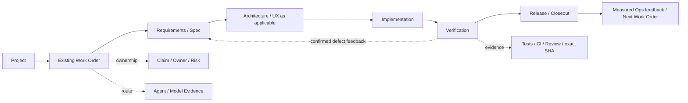

# SundayFamily — SDLC Virtual Flow: UI/UX Integration & Delivery Roadmap

**Status:** PROPOSED / NON-BINDING / REVIEW REQUIRED  
**Drafted:** 2026-11-21 (Asia/Bangkok)  
**Program:** SFU26 SundayFamily Unified Dashboard — additive module only  
**Authority home (once accepted):** `aase7en/A-Wiki-Conductor` under the existing SFU26 program and a separately accepted, non-overlapping Work Order  
**Intended UI placement:** `Work & Lanes` > `SDLC Virtual Flow` (secondary tab/view; no new top-level domain)  
**Scope:** visual/interaction design, read-model projection and testable feature plan; no current repo mutation or rollout authorized by this draft.

> **Important**: The four user-supplied SundayFamily screenshots are design references, **not verified deployed product screenshots**. Existing React main is a simpler Monitor shell, and UX-2 is under active PR review as of 2026-11-21. New SDLC changes must follow the accepted UX-2 lineage, not race or overwrite its frontend owner. No screenshots, mock metrics, colors, or suggested API shapes establish runtime truth.

## 1. Executive decision

Adopt a **read-only-first, evidence-first 2D Hybrid Directed Graph** combining a connected flowchart (what depends on what) and a mind-map (how goal, evidence, risk, owner, agent and result relate). Reuse existing A-Sunday Conductor work/task/claim/review authority, A-Wiki knowledge/skills, React/TypeScript/Vite app shell, read model, A-Conductor Monitor API/SSE and the existing SundayFamily Color E-Ink Manga Design System.

This is a **view** of the real work lifecycle; it must never become another task database, scheduler, review gate, claim authority, local browser state truth, or direct SundayMCP execution UI. For v1, users inspect evidence. Later mutation, if needed, is independently scoped through the accepted A-Conductor Command Gateway with authorization, ownership, replay and audit gates.

## 2. User value and measurable questions

The screen must answer without opening multiple unrelated tools:

1. What is the current Work Order goal and the next safe action?
2. Which SDLC phases are applicable to this task, and what is their evidence-backed state?
3. What dependencies are unresolved and which work can run in parallel?
4. Which owner/agent/model worked on each node, and is it **authorized** to change that scope?
5. What artifact, exact SHA, CI run, review, test and timestamp support a badge?
6. Does this path require user approval, independent review or a security gate?
7. What went wrong, what is blocked, and which dependency/phase should be revisited?
8. After session/model/device interruption, can another agent resume without relying on chat memory?

Success requires truthful navigation, fewer manual evidence lookups and no increase in false-ready/completion claims. Any speed or time savings must be measured during pilot, not invented.

## 3. Confirmed alignment / source anchors

- Design baseline: `docs/design/sunday-family-design-system.md` (accepted muted Color E-Ink / manga, Thai-first, evidence-first, low motion).
- Existing UX structure and seven-domain navigation: `docs/design/2026-11-10-sunday-family-ux1-design.md`, operator decisions on Issue #743 (all 5 UX-1 questions resolved; Fleet monitor-only v1).
- Runtime boundary: `docs/contracts/sunday-family-web-runtime-boundary-v1.md`: UI cannot write directly to SRM or claim project truth.
- Master roadmap: `docs/plans/2026-11-13-sunday-family-unified-dashboard-routing-roadmap.md` (SFU26, do not duplicate master roadmap).
- Execution safety: `00-AGENT-ENTRY.md`, `AGENTS.md`, `PROJECT-GRAPH.yaml`, current Work Orders, repo-local claims.
- UX-2 implementation in progress: Issue #774, PR #776; CI evidence is not by itself visual/independent acceptance.
- A-Wiki is knowledge/skills authority; A-Wiki-Conductor is control/governance authority; SunDayRemoteMCP is capability/execution substrate; SundayFamily Web is a reader.

**Verified at drafting:** GitHub `A-Wiki-Conductor/main@6a137273a6caa2edfa6912942c20b3dc0aab2902`; PR #776 OPEN with reported exact-head CI 4/4 PASS, visual/independent acceptance gates not yet fully closed. Revalidate at implementation start; this is a time-bound snapshot, not future truth.

## 4. UI information architecture (IA)

Existing left navigation and header stay intact. Entry point: `Work & Lanes` > `SDLC Virtual Flow` secondary tab near `Lane Overview` and `Work Orders`. Under one page, offer progressive disclosure:

- **Project Map:** project -> current milestones -> Work Orders and blocked dependencies; summary only.
- **Work Order Map (primary v1):** one selected Work Order -> applicable SDLC stages -> their dependent tasks/gates/evidence.
- **Task / Evidence Detail:** selected node -> drawer containing task/WO identifier, owner, risk, status, last observed time, evidence, source ref, exact branch/SHA when permitted, current gate, reason, next action.

Cross-cutting filters: project, Work Order, stage, lane, evidence type, status, owner, freshness; reset view and fit-to-screen. User can change layout, search, expand/collapse or highlight relationships but these are **view-only local preferences**.

Do not merge independent concepts:

| Dimension | Meaning | Truth handling |
|---|---|---|
| SDLC stage | Discover, Requirements, Architecture, UX, Build, Verify, Release, Operate/Improve | Presentation grouping; actual requirements/gates determine applicability |
| Functional lane | Docs, UX/Design, Frontend, Backend, Data, MCP, Review, etc. | Existing work/ownership classification |
| Runtime/task state | READY, RUNNING, WAITING, BLOCKED, DEGRADED, VERIFIED, UNKNOWN, etc. | Derived solely from accepted task/run/evidence authority |
| Risk class | R0/R1/R2/R3 | Existing policy classification, not UI-assigned |
| Gate | Required approval/test/CI/review/claim/merge | Source-backed decision and explicit reasons |

Avoid a fake strictly linear lifecycle: independent READY tasks may be concurrent; release/closeout requires all relevant actual gates, not just visually reaching the final node.

## 5. Graph design / topology

### 5.1 Node classes

1. Project root / milestone
2. Work Order / requirement / acceptance criterion
3. SDLC stage / architecture decision / UX design node
4. Bounded implementation task / claim owner / execution attempt
5. Validation gate (tests, CI, security, independent review, operator approval)
6. Evidence artifact (ADR, PR, commit SHA, test, CI, log, accepted receipt)
7. Blocker / defect / risk / retry-reconciliation
8. Continuous-improvement feedback link (issue or next accepted Work Order)

### 5.2 Edge semantics

- **Solid pencil arrow**: hard dependency. Render only if an actual dependency exists.
- **Fine dotted arrow**: associated evidence/reference (non-blocking).
- **Soft dashed curved loop**: corrective change/feedback to an earlier phase; not the same as a new task authority.
- **Double-ended link**: contextual relationship with no scheduling meaning.
- **Blocked edge**: dependency with an explicit blocking reason. Always include a label/icon; never convey critical meaning by color alone.

Use an underlying DAG for strict execution dependencies; overlay feedback relations as visually distinguished non-DAG edges. Do not introduce an accidental cycle into the authoritative scheduler. For R0/R1, stages not required by policy are `NOT_APPLICABLE (reason)` rather than incorrectly shown as VERIFIED.

### 5.3 Read-only relationship diagram



The Mermaid graph is a **design model only**; no node should be displayed as successful absent real evidence.

## 6. Visual design specification (existing SundayFamily style)

**Use, don't replace, the canonical tokens.** Candidate values from the accepted design-system file:

| Role | Design token/candidate |
|---|---|
| Paper canvas | `--sf-bg-canvas: #F4EFE6` |
| Surface | `--sf-bg-surface: #F9F6EE` |
| Main ink | `--sf-text-primary: #1E2220` |
| Secondary ink | `--sf-text-secondary: #464C48` |
| Structural stroke | `--sf-border-ink: #323734` |
| Running | `--sf-status-running-bg: #D2E2DF` |
| Verified | `--sf-status-verified-bg: #D6E3D4` |
| Waiting | `--sf-status-waiting-bg: #F1E1B8` |
| Blocked | `--sf-status-blocked-bg: #ECCAC2` |
| Degraded | `--sf-status-degraded-bg: #F2D5B3` |
| Focus | `--sf-focus-ring: #234B66` |

Typography: Thai-first legible sans (`IBM Plex Sans Thai` / `Noto Sans Thai`, after license/loading checks), English technical labels smaller but still legible, monospace only for SHA, code, task ID. The user requests anime and pencil handwriting: express this in arrows, section dividers, hand-ink iconography and margin sketches, **not** by rendering all operational text as hand-written fonts that damage legibility.

Pencil/Anime design: 1–1.5 px dark ink strokes with slight deterministic edge irregularity (not random trembling per frame); lightly hatched node corners only outside text/evidence; tiny rural scenery accents at graph margins; retain brand portrait and family header from approved assets. Meaningful content areas stay clean. Do not use glassmorphism, neon, saturated gradients or heavy 3D.

## 7. Motion and interaction contract

Motion is a lightweight affordance, not a progress oracle. Recommended initial timings (candidates to test):

| Trigger | Motion proposal | Restriction |
|---|---|---|
| Open flow | One-time pencil-line draw along the *visible* graph's already-known connections, 180–300 ms | Does not suggest running progress or automatically repeat |
| Selection | Focus outline / mild shadow or color transition, 120–180 ms | Visible keyboard focus; no color-only state |
| Expand branch | Node disclosure and connector morph, 160–240 ms | Stable node order, no sudden camera jump |
| New verified evidence | Small one-shot ink checkmark, max 200 ms | Only after validated source receipt; not on optimistic API response |
| Blocked or stale | Static warning icon, reason and timestamp; optional one-time background change | No shaking/red flashing/pulsing alarm |
| Pan/zoom | Direct user-driven interaction | Inertia disabled or bounded; avoid motion sickness |

Use HTML/CSS/SVG as the default low-cost render stack. For v1 a bounded SVG-edge + accessible DOM-node renderer is preferable; consider a graph library such as `@xyflow/react` only after proving needed graph size/layout behavior and bundle/a11y/performance trade-offs. No mandatory heavy graph dependency or persistent animation engine.

Support `prefers-reduced-motion: reduce` by suppressing stroke drawing/morphing, substituting instantaneous state change. Never animate if evidence is stale/unknown as though a task is executing.

## 8. State and provenance mapping

All visible data is read-only projections from existing authorities. Proposed conceptual DTO fields (NOT an existing API contract):

```ts
// Candidate design schema; add no endpoint until existing DTO/read path is audited.
type FlowNodeView = {
  id: string;
  kind: 'project'|'work_order'|'stage'|'task'|'gate'|'evidence'|'blocker';
  label_th: string;
  label_en?: string;
  work_order_ref?: string;
  stage?: string;
  lane?: string;
  status: string;       // accepted vocabulary only; unknown is explicit
  status_reason?: string;
  owner_label?: string; // sanitized/public-safe
  source_ref?: string;  // safe bounded citation/reference
  observed_at?: string; // authoritative observation time
  freshness?: 'FRESH'|'STALE'|'UNKNOWN';
  next_safe_action?: string;
};
type FlowEdgeView = {
  id: string;
  from: string;
  to: string;
  relation: 'dependency'|'evidence'|'association'|'feedback';
  reason_ref?: string;
};
```

Implementation must reuse actual existing DTO fields and API/SSE route conventions. If this requires an additive projection, implement it in A-Conductor read model (not browser state), with strict allowlists, bounded count/depth, source revision/time/reason, stable IDs, redaction and deterministic unit tests. A new network endpoint is optional and needs its own accepted WO if the current read transport cannot carry the projection.

**Truth rules:**
- `UNKNOWN` is not 0, Ready, or Done; report source absence and reason.
- `ACCEPTED != EXECUTED != VERIFIED != COMPLETED`.
- No evidence => not VERIFIED.
- A finished worker claim does not prove completion; reconcile worktree, SHA, tests, review, CI and accepted closeout.
- Connectivity heartbeat is not progress.
- Stale snapshot/SSE disconnect => indicate `STALE`/`UNKNOWN`; do not silently retain a green ready indicator or unqualified countdown.
- No private paths, tokens, tunnel IDs, raw PHI or sensitive logs in browser payloads.

## 9. Key screen interactions / stories

### Story A — operator checks a feature
Select project > select WO > see relevant SDLC map > click “Verification” > inspect applicable tests, CI and reviewer evidence. Display `NOT_AVAILABLE` when no accepted source exists. Link to real GitHub or evidence URL only when allowlisted.

### Story B — task blocked by owner/claim
Graph shows a blocked dependency with typed reason (e.g. `CLAIM_CONFLICT`) and next safe action; no automatic reassign/retry button in v1. Existing owner and worktree remain protected.

### Story C — agent reports done
Graph shows terminal result as awaiting reconciliation (when source supports this) rather than green completion. It becomes VERIFIED only when required exact-SHA evidence/CI/review gates pass.

### Story D — mobile / narrow screen
Show compact stage index/list instead of forcing tiny unreadable graph. Drill down via accordion/drawer. Keep source and timestamp visible; preserve accessible link targets and keyboard order.

### Story E — recovered session
The same authoritative Work Order and durable evidence renders after ChatGPT/client restart; view state may reset without loss of task truth. `RUNNING` is not redispatched.

## 10. Integration with existing SundayFamily features

| Existing area | SDLC feature integration |
|---|---|
| Overview | Small summary: current WO, blocked gates, links into Work & Lanes map (no duplicate charts) |
| Work & Lanes | Primary new `SDLC Virtual Flow` tab; same project/WO selection as existing views |
| Projects | Deep link into the project's filtered Flow Map |
| Evidence & Verification | Selected-node evidence references link to existing evidence area |
| Fleet & Devices | Show execution device only if identity and freshness source-backed; never infer machine health from task status |
| Tools / Skills | Show selected Skill and provenance/readiness only when supported by A-Wiki and accepted task packet |
| Jev Advisory | Advisory explanation may link to nodes; no approval/merge authority |
| Reports | Later metrics: dwell time, blocked time, verified completion ratio, rework, source-freshness distribution |
| Settings | Read-only configuration/effective policy status; no new mutable controls in v1 |

The seven accepted top-level domains must remain unchanged; exact submenu placement must reconcile the accepted UX-1 IA and current frontend PR.

## 11. Delivery roadmap — incremental candidate slices

**Hard dependency:** do not start mutating the `web/sunday-family` family until existing UX-2 PR #776 has reached an accepted non-overlap boundary and its current owner/claim is reconciled. Candidate labels below are planning identifiers only, **not new Work Orders or Issue numbers**.

| Slice | Scope / owner type | Dependencies | Deliverable | Acceptance |
|---|---|---|---|---|
| P0 **Reconcile** | Integrator, read-only | Current UX-2 #774/#776, SFU26 status, claims, target SHA | One authority/overlap map and bounded implementation sequence | No duplicate WOs, no stolen UI writer |
| P1 **Experience Spec** | UX/design/docs lane (R1/R2 based on binding changes) | P0 | User flows, graph states, responsive wireframes, motion tokens, error/empty/stale rules, design-to-existing-components mapping | Thai-first, accepted IA, no new top-level menu; review of references/licenses |
| P2 **Evidence Mapping** | Backend read-model (R2, R3 if privacy/auth boundary changes) | P0+P1 | Stage-to-existing-task/gate/evidence mapping, fixture corpus, optional safe additive projection | Deterministic mapping, sanitized fields, no new authority or hidden API mutation |
| P3 **Canvas MVP** | One frontend owner, R2 | P1+P2 + UX-2 frontend free/accepted | Project/WO selection, bounded SVG connector graph, stage cards, static status chips, fallback list | Desktop/mobile, graph facts match fixture, no stale-as-healthy |
| P4 **Evidence Drilldown** | Frontend same or next owner, R2 | P3 | Node drawer, dependency highlights, actual source links, typed blockers, source/freshness timestamps | Keyboard and screen reader access; no fabricated URLs/status |
| P5 **Pencil Motion & Accessibility** | UI + independent QA, R2 | P4 | One-shot stroke animation, transitions, reduced-motion, contrast, zoom and visual regression | Measurable render performance, 200% real browser zoom, reduced-motion, no text clipping |
| P6 **Integrate & Accept** | Integrator/reviewer, R2/R3 if runtime boundary touched | P3–P5 | Scoped PR(s), frozen SHA, tests/CI, independent UX + evidence review, post-merge proof, checkpoint | Exact-head CI/review, current-read-model E2E, rollback, owner/claim release |
| P7 **Optional Advanced Graph** | Follow-up WO only | Proven complexity/usage | auto-layout, multi-WO dependency rollup, interactive graph library if justified | explicit adoption evidence; separate perf/a11y acceptance |

**WIP:** follow existing global budget (up to 3 mutable non-overlapping lanes + 1 independent read-only review); never overlap P3/P4/P5 changes with an existing frontend owner or source gate. Parallel docs/user research can proceed separately when safe.

### Earliest useful release / MVP

Deliver P0–P3 with **read-only selected Work Order flow**: correct node/edge identity, deterministic statuses, stage names, 2D connectors, current sources and clear fallback when no data. Gate P4–P6 for polished v1 acceptance. Motion is **not** a prerequisite for truthful read-only usefulness.

### Priority

- P0: ownership, current truth and established UX-2 acceptance.
- P1: exact product spec; derive graph semantics before pretty lines.
- P2: truth data; otherwise fake graph risks misleading operators.
- P3: usable static interactive prototype with existing React primitives.
- P4/P5: evidence navigation and aesthetic polish, only after the data is trustworthy.
- P6: verification/review/integration, not a separate tracking system.

## 12. Acceptance and verification matrix

| Test boundary | Mandatory proof |
|---|---|
| Semantic | Stage / lane / state / risk / gate are different dimensions; hard dependencies are actual only |
| Provenance | Node, edge and badge trace to accepted source, timestamp and reference |
| Negative cases | unknown enum, missing optional source, malformed evidence, absence vs empty, conflicting source, stale SSE, disconnected worker, terminal-unharvested |
| Safety | no direct browser-to-SRM mutation; no secret/private path/PHI; no browser-created claims; no unsafe retry |
| Layout | 390 / 768 / 900 / 1280 / 1440 / 1920 px; long Thai labels; 200% real zoom; no overflow |
| Accessibility | WCAG 2.2 AA target, keyboard focus/traversal, non-color indicators, screen reader labels, alternative list/tree view, reduced-motion |
| Performance | benchmark on ordinary Windows and macOS hardware; fixed bounds for nodes/edges/layout; no continuous canvas animation |
| Assurance | targeted tests + CI, independent reviewer, frozen SHA, exact remote diff, post-main proof where relevant |
| Continuity | resume from Work Order + actual durable evidence; no memory-only status or duplicated task authority |
| Rollback | return to prior accepted Work & Lanes view without discarding source/claims/task state |

Suggested fixtures: 0 nodes, 1 WO, 10 stages, 40 tasks, blocked dependency, concurrent independent tasks, cross-repo task, missing CI, stale evidence, mismatched ownership, disconnected SSE. These are testing scenarios, not verified runtime data sizes.

## 13. Risks and mitigations

1. **Graph looks alive but is lying:** block animation for unverified execution; source-backed state only; explicit unknown.
2. **Spaghetti connectors and tiny text:** default collapse, focus on one WO, task/edge bounds, list fallback, progressive disclosure.
3. **Anime styling harms readability:** ink illustrations only margins/brand/empty state; main data in clean cards; Thai fonts and contrast tests.
4. **Overlapping React feature claims:** complete/reconcile PR #776 and subsequent frontend owners before writing same scope.
5. **Duplicate governance/skill engine:** no independent scheduler, Task DB, Skill Registry, claim store, review authority; reuse A-Wiki and A-Conductor contracts.
6. **Leaking sensitive evidence:** server-side allowlists, source sanitization, no raw logs/secret fields in client.
7. **Heavy graph dependency / CPU:** SVG/DOM first, benchmark device; `@xyflow/react` only after documented trade-off and accepted WO.
8. **False inference from design screenshots:** sample visuals never claimed as live data or current version numbers.
9. **Large all-in-one PR:** separate design/projection/frontend/QA slices with exact SHA and impact-bound review.
10. **Cross-repo integration drift:** if SRM interface genuinely needed, classify CROSS_REPO and verify exact `{AWC@SHA, SRM@SHA}` pair with rollback; otherwise avoid SRM changes.

## 14. Relationship to external SDLC skills

Use selectively as **instruction patterns and checklists**, not new authority:

- `addyosmani/agent-skills`: spec/plan/review/test and stage-specific interviewing.
- `zeeshanhanif/agentic-sdlc-kit`: requirements-to-design-to-verification traceability mapping.
- `faparicior/sdlc-skills`: domain and change-flow considerations for R2/R3.
- `acairns07/free-engineering-plugins`: optional PRD/architecture/security/QA checklists.

Skill intake requires provenance/license review, pinned Git SHA, script/hook audit and conflict check with A-Wiki's existing registry and A-FastTask. Do not `npx skills add --all` into production or allow an external Skill to override the accepted Work Order / claim / review contract. This skills/policy intake can be a separately accepted governance follow-up; SDLC graph v1 does **not** depend on installing all these Skills.

## 15. Proposed Work Order structure (for integration, not yet created)

- **Parent:** Existing SFU26 program #744 / current #771 roadmap requirements; one scoped new task once duplication check passes.
- **Child A:** `SDLC-FLOW-DESIGN` — docs-only UX & interaction spec with screenshots as visual references.
- **Child B:** `SDLC-FLOW-PROJECTION` — deterministic normalized read-model proof and fixture coverage.
- **Child C:** `SDLC-FLOW-REACT` — read-only graph tab, progressive disclosure and a11y.
- **Child D:** `SDLC-FLOW-ACCEPTANCE` — visual QA, source-truth, CI, exact SHA and closeout.

Child labels are conceptual. The integrator must assign valid numeric Work Order IDs/issue links under the existing authority and establish non-overlapping claims before mutations. Do not create a new ‘SDLC scheduler’ or project authority.

## 16. Definition of Done for the entire feature

- Operators can see the *real* selected WO and its applicable SDLC stages without inventing state.
- Node relations, stage badges and blockers are grounded in traceable source identifiers, including missing/stale behavior.
- Evidence drawer shows correct accepted references and exact-SHA/test/CI/review where applicable.
- No new top-level nav, Task DB, claim/review authority or SRM control path.
- Thai-first Pencil/Manga style matches accepted tokens; primary text remains legible.
- Verified cross-device responsive/keyboard/a11y/reduced-motion and low-spec rendering.
- Exact-SHA tests, CI, independent review, accepted merge, post-main verification, continuity fold and owner release are completed under the applicable existing gates.

## 17. Immediate safe next steps

1. Recheck PR #776 and Issue #774 status, remaining independent UX/QA gates, and any intervening merged related frontend work.
2. Inspect active Work Orders, claims and real local worktrees before claiming the docs/UI scope.
3. Bind this plan **as an additive SFU26 design proposal**, not a replacement roadmap. Read the accepted UX-1 design packet and current frontend code at the claimed base SHA.
4. Create the smallest approved docs-only UX/design Work Order in a fresh non-overlapping scope, then perform P1.
5. Only after P1 is reviewed and read-model source mapping confirmed, admit P2/P3 in isolated lanes.

**No code/repository/issue was modified by creation of this draft.**

### Source locations to re-check

- https://github.com/aase7en/A-Wiki-Conductor/blob/main/AGENTS.md
- https://github.com/aase7en/A-Wiki-Conductor/blob/main/PROJECT-GRAPH.yaml
- https://github.com/aase7en/A-Wiki-Conductor/blob/main/docs/design/sunday-family-design-system.md
- https://github.com/aase7en/A-Wiki-Conductor/blob/main/docs/contracts/sunday-family-web-runtime-boundary-v1.md
- https://github.com/aase7en/A-Wiki-Conductor/blob/main/docs/plans/2026-11-13-sunday-family-unified-dashboard-routing-roadmap.md
- https://github.com/aase7en/A-Wiki-Conductor/issues/743
- https://github.com/aase7en/A-Wiki-Conductor/issues/771
- https://github.com/aase7en/A-Wiki-Conductor/issues/774
- https://github.com/aase7en/A-Wiki-Conductor/pull/776
