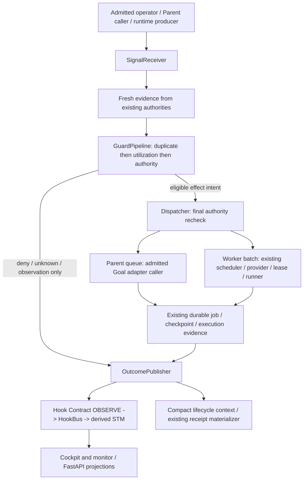

# ORCH-1 Orchestration Foundation Design

Issue: #709

Status: DESIGN_ONLY / PROPOSED / GPT_INTEGRATOR_DECISION_REQUIRED.
Classification: R3 / CONTROL_PLANE_ONLY. This packet grants no source or runtime admission.
Author: design analyst `ses_e95e022fbffeWlqbqCJRBmMfLR`.
Claim: [ORCH-1-DESIGN-001 / 6372519436](https://github.com/aase7en/A-Wiki-Conductor/issues/709#issuecomment-6372519436).
Evidence date: 2026-10-23 UTC; live evidence supersedes this snapshot.
Repository: `aase7en/A-Wiki-Conductor`.
Base: `157fbe1af79cccf752b91e928dedf94184917d1a` (fresh origin/main).
Worktree: `A:\GitHub\_worktrees\AWC-orch1-design`.
Branch: `docs/orch1-foundation`.
Device: `ff685af5-9031-4b3b-84ff-61dc8f1a840c` / Windows.
Mutable scope: this document only; commit/push allowed, NO PR/merge.

## 1. Decision Summary

Recommend **WRAP/EXTEND the existing application composition**, not a new scheduler,
daemon, durable inbox, claim store, model router, or task state machine. Introduce
one explicit, dependency-injected orchestration application boundary, with four
logical components: SignalReceiver -> GuardPipeline -> Dispatcher -> OutcomePublisher.
These are responsibilities, not four services or mandatory class hierarchies.
Start with one small module and fixture-owned ports; split only when justified.

The missing capability is a real caller connecting accepted policies to effects.
An uncalled helper, a hook reminder, or an HTTP `accepted` response does not deliver
ORCH-1. Acceptance must trace a registered production entry to the existing guarded
effect and its durable outcome. Offline fixtures can prove that path's composition,
but cannot certify live queue/worker activation.

Keep two effects distinct: **Parent queue submission** and **worker execution**.
An enqueue chooses exactly one of these targets. A queued Parent instruction may
later request work, but must then pass normal task/claim/lease gates again. Never
enqueue a Parent instruction and dispatch its worker work as two effects of one signal.

All names, new signal fields, reason codes and slices below are proposals, not
existing APIs. Existing source symbols are called out explicitly. Design delivery
is not R3 architecture acceptance or authorization to implement these proposals.

### Alternatives

| Approach | Trade-off / failure mode | Disposition |
|---|---|---|
| Put orchestration in Codex lifecycle hook | Per-event adapter has no admitted queue writer, canonical task or scheduler evidence; adds transport/state and violates accepted stateless boundary | Reject |
| Put a new scheduler and durable inbox behind FastAPI | Duplicates jobs/READY/dedupe/recovery; HTTP lifecycle becomes runtime ownership; adds migration and retry failure modes | Reject |
| Inject an in-process application boundary into existing admitted composition roots | Reuses authorities, offline-testable, no new persistence; real producer registration and serialization must be proven | Recommend WRAP/EXTEND |
| Add only reminders or another pure adapter | Small and reversible, but leaves both #580 and #545 consumer gaps intact | Companion documentation only, not foundation completion |

Code/config changes are reversible before activation. A queue append, provider
launch or governance mutation is not undone by reverting code. Do not compensate
for ambiguity by deleting queue items, releasing claims, or launching a replacement.

## 2. Evidence And Reuse Audit

Read #709, full #580 and #545 bodies/comments, #547, full #549 body/comments,
and the accepted [#580 consumer packet](WO-P1-580-consumer-design.md). Inspected
the four requested guard/classifier/hook/Goal-adapter sources on origin/main.
The current base includes parity PR #708; the protected root checkout is stale
and dirty and was not advanced or used for edits.

Reproduced on the base:
`git grep -n -E "evaluate_bootstrap_guard|queue_submission_task_key|CodexGoalApiAdapter|classify_utilization" -- src scripts .codex`
finds definitions and guard self-reference only, no production consumer.
This is a bounded repository-source finding, not proof that no external launcher exists.

### Component Findings

| Existing component / symbol | Verified responsibility | ORCH-1 decision |
|---|---|---|
| `codex_queue_submission_guard.py::evaluate_bootstrap_guard`, `queue_submission_task_key` | Pure #583 queue absence/duplicate/interrupted-turn policy; PROCEED is not admission | REUSE unchanged for Parent enqueue/replay only |
| `codex_goal_api_adapter.py::CodexGoalApiAdapter.execute` | One injected request, one bounded observation; QUEUE_LIST/TURNS_LIST are one page each | WRAP at actual admitted caller; do not silently change generic QUEUE_ADD semantics |
| `a_faster_utilization_guard.py::classify_utilization` | Pure #517 projection of structured occupancy/READY/quota/activation facts | REUSE unchanged; NEW bounded authority-backed fact collection/composition |
| `.codex/hooks/a_sunday_lifecycle.py` | Context injection, direct-Kilo denial, interrupt guidance, receipt-mediated Stop | EXTEND compact guidance only if separately claimed; no transport/scheduler |
| `hook_bus.py::HookBus.accept/drain` | Existing bounded, single-owner Hook Contract v1 ingress; in-memory dedupe, ordering, backpressure | REUSE for observations, never use bus admission as execution permission |
| `hook_stm.py::HookStm` | Derived TTL/bounded working set; restart/rebuild semantics, not authoritative truth | REUSE; stale/missing STM triggers fresh authority reads, never dispatch from cache |
| `control_hook_adapter.py::normalize_control_event` | Maps supported ControlEvent types to sanitized OBSERVE envelopes | REUSE existing mappings; new outcome mapping needs an explicit additive contract/test, not arbitrary fields |
| `monitor_api.py::MonitorApiServer` | Authenticated loopback stdlib GET snapshot + NDJSON stream, inert before start | REUSE legacy observation transport; not command ingress, not SSE |
| `cockpit_projection.py` | Pure immutable projection over injected observations with provenance/UNKNOWN/STALE | REUSE for display; do not reverse its projection into claims or scheduling authority |
| `lifecycle_coordinator.py::LifecycleCoordinator.observe/execute` | Worker START/STOP/RESTART observation -> plan -> checkpointed execution/state persistence | REUSE worker lifecycle authority; it is not the Codex hook or a task orchestrator |
| `desktop_control.py::DesktopControlService` | Existing application facade, canonical DB identity check, job control/runtime activation, worker commands and cockpit readers | WRAP injected orchestration entry here when needed, not a second desktop control service |
| `runtime_activation.py::activate_production_runtime` | Explicit runtime composition; desktop facade checks canonical DB before calling it | EXTEND composition only under fresh WO; do not activate automatically on startup/refresh |
| `parallel_ready_execution.py::ParallelReadyExecutor.execute` | Executes scheduler-owned SchedulePlan/tasks with provider/lease/runner authorities | REUSE production-required provider authority and pre-dispatch chain, not raw subprocess calls |
| `job_execution.py` / `job_control.py` / `operator_dispatch.py` | Existing durable job/backend and operator command boundaries | REUSE canonical job lifecycle/checkpoints; no parallel ORCH task store |
| `web_api.py::create_app`, `WebFeed` | FastAPI snapshot/SSE projection plus later command/session-metadata endpoints | REUSE authenticated presentation transport, not runtime scheduling ownership |
| Preserved #549 branch `feat/wo-p1-549-a-faster-autorefill` | Historical executable bridge design, mutable refill explicitly dependency-blocked | REUSE design lessons; branch code is not accepted main and must not be imported/copied as accepted behavior |

### Upstream And Parallel-Work Audit

Authoritative A-Wiki GitHub main was queried as
`16897b2d34f3ff0de0938f7651cf19bbce106b43`; local origin/main matches that SHA,
while the local checkout HEAD is older `566637ac8d2636d6c63eda2bd6ebe81b55bd3d72`.
Read upstream `origin/main:skills/awiki/a-claim/SKILL.md` and
`origin/main:docs/protocols/crew.md`; inspected protocol/script paths and live
Issue #58. Local TTL claims are same-machine acceleration, not cross-machine
canonical ownership. Crew is role routing, not a replacement for Conductor runtime.
The accepted dual-claim adjudication is #58 comment 5597445824; source migration
remains pending. Conductor #551 is still OPEN and forbids guessing the reader shape.

Binding ownership is [the integration contract](../contracts/a-wiki-a-conductor-integration.md):
A-Wiki owns durable repo/work-order coordination identity; Conductor owns runtime
leases, jobs, admission and execution. `operator.v1` remains the canonical operator
vocabulary per [its contract](../contracts/operator-command-api.md). GE-0008 provides
reuse direction but its own status still records rereview required; do not present
all proposed GE-0008 implementation phases as accepted production behavior.

Worktree census and #580/#545/#549 issue evidence were reconciled. #580's design
claim is released. Its exact external enqueue registration/serialization owner is
still unknown. #545 source acceptance is historical fact; its operational/native
Goal concerns are distinct. #547 already has bus/STM source, not a greenfield bus.
PR550 closure releases overlap, NOT #551's claim-binding gate. No old PR/branch,
A-Wiki file, global hook configuration or shared continuity file is changed here.

## 3. Component Architecture

### SignalReceiver

One proposed `OrchestrationService.handle(signal, admitted_context)` invocation
per event/intent. The application supplies already-bound read/effect ports; imports
and construction perform no I/O or activation. Receiver validates closed types,
source identity, target and task binding before authority reads. A claimed source
string in JSON is not authentication. Caller identity comes from the existing
authenticated operator/launcher/runtime boundary, separately from the payload.

Enqueue/replay are synchronous bounded requests in the first slice, not queued in
HookBus. Observational lifecycle/utilization events may use the existing bus but
can only request reconciliation/reclassification. The receiver holds no durable
delivery state, generic task registry, poll timer, or retry loop. Saturation rejects
new dependent work explicitly; never drop a command and report success.

### GuardPipeline

Validate trusted ingress BEFORE evidence reads. The requested guard order then
applies to fully bound inputs: **duplicate -> utilization -> authority**. This is
not permission to defer authentication or leak another task's queue evidence.
Each stage returns code + evidence refs + applicability; no stage mints authority.
All stages are short-circuiting; no effect when a required stage is unknown.

| Stage | Parent queue target | Worker batch target |
|---|---|---|
| Duplicate/replay | Collect complete bound queue/turn evidence; call #583 | Reuse current durable execution/dedupe/recovery admission for each exact selected task; #583 is not a worker deduper |
| Utilization | Apply #517 when intent is A-Faster refill-driven; explicit operator bootstrap is NOT_APPLICABLE, not A_FASTER_ACTIVE by inference | For refill, derive #517 facts freshly and cap mutable/review assignments independently; explicit non-refill work remains under existing WIP/admission without forced A-Faster activation |
| Authority | Current Parent/transport/writer admission, canonical intent, no owner/result drift, serialization across all queue producers | Exact scheduler READY plan/task map, durable repo claim binding when required, runtime lease/provider/guard/hotspot authority and current worktree identity |

For observation-only signals, duplicate event suppression is telemetry hygiene, not
effect dedupe. Utilization reclassification can publish an obligation; lifecycle
events can request recovery. They cannot authorize a launch. A positive
`AUTO_REFILL_REQUIRED` is never upgraded into an execution capability.

`classify_utilization` takes `UtilizationFacts`: activation, mutable/review occupancy,
independent READY candidate counts, structured quota admission, route readiness,
direct-labor flags and policy budgets. Build these only from existing authority
readers. Strictly validate enum/bool/int fields before constructing facts; do not
rely on dataclass annotations as runtime validation. Default limits remain 3 mutable
and 1 independent review globally. No device-local budgets or invented work.
NO_INDEPENDENT_READY_WORK can coexist with some fillable work: use typed verdict
fields and actual selected tasks, not `blockers == ()` as a universal admission rule.
The accepted classifier's GLM gate remains unchanged; an authorized fallback needs
existing provider routing policy, not relabeling UNKNOWN quota as AVAILABLE.

### Dispatcher

Resolve the explicit target; perform at most one effect call/batch per invocation.
Worker selection is owned by existing READY/scheduler/candidate machinery. Require
production provider authority (`require_provider_authority=True` where assembling
ParallelReadyExecutor), task-bound PRE_DISPATCH and final live HEAD/scope checks.
Do not bypass them by calling a runtime backend or shell directly.

Parent queue uses the existing injected `CodexGoalApiAdapter`, admitted only for
its proven 0.159.0/0.160.0 subset. Resolve current Parent from durable role evidence,
not historical thread IDs. Do not invent queue/start, pause or watchdog operations.
Queue append does not dispatch a worker and does not mean the Parent ran.

Final checks and effect occur inside the EXISTING authority's serialization scope.
An in-process mutex is not cross-device queue serialization; a thread's single-writer
lock does not necessarily serialize its queue producers. If that owner cannot be
proven, block Parent writes as `ORCH_QUEUE_SERIALIZATION_UNPROVEN`. For worker
batches, preserve the executor's explicit requirement to serialize admission per
provider or supply atomic authority-backed inflight counts. Do not introduce an
ORCH lock database, file lease or semaphore service to hide this gap.

### OutcomePublisher

Return one bounded immutable outcome from the invocation; authoritative execution
states remain those of existing jobs/leases/execution records. Proposed decision
labels: `OBSERVED_ONLY`, `NO_ACTION`, `DENIED`, `RECONCILIATION_REQUIRED`,
`SUBMISSION_OBSERVED`, `DISPATCH_OBSERVED`. They are response labels, not a new
persisted lifecycle. `DISPATCH_OBSERVED` is not verified task completion.

Audit reuses owning job/execution events and `DurableJobControlService.checkpoint`
references. The existing `SQLiteControlEventLog.append(event_type,worker_id,project_id)`
is narrow, not a generic arbitrary-JSON audit API. Do not fabricate event enum values
or force a queue submission into a fake worker record. ORCH-1/0 must freeze the
owning audit/checkpoint mapping for a Parent intent; absent a suitable existing
owner, side-effect admission stays blocked pending integrator decision. Preflight
denials can be returned as bounded observations without manufacturing a durable job.

After canonical evidence is recorded, publish a sanitized Hook Contract OBSERVE
projection and compact context. Reuse supported control-event normalization;
introduce a new mapping only under explicit schema/mapping tests. The Codex hook
has no ORCH outcome callback or TaskStart event today. Deliver compact evidence
refs through existing caller tool output and the existing NightShift receipt
materializer, not a made-up hook event or new receipt fields. Stop may consume only
the accepted #531 receipt; do not generate CONTINUE directly from utilization.

Required audit failure BEFORE an effect blocks it. After a possible effect, audit
or publisher failure returns reconciliation with any retained canonical effect IDs;
never replay execution to repair telemetry. HookBus/STM/monitor failures degrade
observability only. Lost observer events are rebuilt from authority, not replayed
as commands. Publisher output never feeds the effect path recursively.

## 4. Signal Contract

### Internal Envelope, Not Another Operator Protocol

Proposed internal immutable DTO with a closed JSON encoding for fixtures and safe
audit transport. External commands still decode via `operator.v1`; the internal
adapter maps supported intents into this DTO. No new public HTTP/MCP/CLI protocol
or operator action is accepted by this document. Unknown external actions fail closed.

| Field | Proposed rule |
|---|---|
| `schema_version` | Exact `orch-signal.v1`; unsupported versions refused, never silently downgraded |
| `signal_id` | Existing producer correlation/event ID, bounded ASCII <=128; correlation only, not idempotency |
| `kind` | Exactly `ENQUEUE`, `REPLAY`, `UTILIZATION`, `LIFECYCLE` |
| `occurred_at` | Valid UTC timestamp; receiver separately records its own observation time; producer time is not freshness authority |
| `source_ref` | Opaque admitted producer reference <=128; must match separately bound ingress context |
| `project_id`, `task_ref`, `work_order_ref` | Canonical existing identities; `task_ref` <=128 for #583; task/work-order required for effects, absent allowed only for project-level observations |
| `binding_ref` | Bounded locator for existing repo/worktree/branch/exact-HEAD/task/claim tuple, not a digest-based capability |
| `payload` | Closed discriminated object from the table below; no generic dictionaries or raw prompt/shell/argv/SQL |

Payload fields are opaque existing refs unless stated otherwise. Resolve through
injected authority readers, never fetch arbitrary URLs or open caller-selected
paths. A missing/unknown ref is not an empty snapshot. No envelope field can carry
`authority=true`, trusted `evidence_complete=true`, quota text or a claimed verdict.

| Kind | Required payload | Behavior and producer |
|---|---|---|
| ENQUEUE | `target` = `PARENT_QUEUE` or `WORKER_BATCH`; `intent_ref`; target-specific `parent_binding_ref` OR `ready_plan_ref` + `task_map_ref`; `trigger` = `EXPLICIT` or `REFILL` | Admitted operator/Parent application asks for one submission or existing scheduler-owned batch; text/operations resolved from bounded accepted packet |
| REPLAY | Same target/intent binding plus `prior_execution_ref` or `prior_submission_ref`, and `recovery_evidence_ref` | Recovery owner requests reconciliation FIRST. Observed active/pending/terminal results are attached/harvested/no-op; new effect only if existing recovery authority explicitly proves replay safe |
| UTILIZATION | `census_ref`, `ready_set_ref`, `activation_ref`, `provider_observation_ref` | Existing runtime producer requests fresh fact collection/classification; missing quota remains UNKNOWN; no command embedded and no launch |
| LIFECYCLE | `hook_event_ref`, `subject_ref` for existing job/execution/worker, `observation_ref` | Only sanitized accepted Hook Contract records from a registered producer; marks relevant authority reads stale/recoverable, never START/STOP/RETRY by inference |

Target-specific keys are exclusive: PARENT_QUEUE requires `parent_binding_ref`
and forbids plan/task-map keys; WORKER_BATCH requires both plan/task-map keys and
forbids Parent binding. REPLAY requires exactly the matching prior-submission or
prior-execution reference for that target, not both. Inapplicable keys are invalid,
not ignored. Resolve all refs against the same admitted project/task binding.

Enqueue with target WORKER_BATCH must name existing jobs/READY tasks, not create
unclaimed work. Parent bootstrap can precede a repo claim only where the existing
governance workflow explicitly authorizes creating that claim. Do not invent a
universal preexisting-claim requirement that would deadlock authorized bootstrap.
At eventual governance consumption, collision/claim/worktree admission runs again.

### Serialization And Validation

Use UTF-8 JSON, strict duplicate-key rejection, exact object/key/type validation,
no NaN/Infinity, lone surrogates or type coercions. Serialize safe DTOs with sorted
keys/compact separators for stable diagnostics; hashes detect drift, not authenticity.
Proposed local bounds: 16 KiB total envelope, depth <=4, <=64 total fields,
<=16 evidence refs where present, each <=256 ASCII characters, and no arbitrary
arrays/batches. Reject overflow before expensive parse/lookup; bound decoder
recursion/numeric parsing too. These limits require contract tests and integrator
ratification; they are not asserted server capabilities.

Do NOT put this command DTO inside Hook Contract v1 as an extra payload. HookBus
accepts only its existing schema (closed keys, <=64 KiB wire). Lifecycle input
resolves `hook_event_ref` to that validated envelope; guard evidence is read directly
from authority, not deserialized from its summary. JSON round-trip conveys data,
never authenticated source identity or an admission receipt.

Outcome fields: `signal_id`, `kind`, existing subject IDs, decision label,
typed `reason_code`, evidence refs, any observed submission/execution IDs and
`observability_degraded`. No raw exceptions, provider output, credentials or prompts.
Return exact existing guard reasons where available; proposed `ORCH_*` codes identify
composition failures only and require a frozen code catalog before implementation.

## 5. Enqueue, Recovery And Race Semantics

Parent sequence under proven existing queue-producer serialization:

1. Resolve canonical task aliases, current Parent binding and admitted channel. Historical UUIDs, issue text and model assertions do not establish identity.
2. Collect QUEUE_LIST and TURNS_LIST through the injected Goal adapter. Validate every outcome's operation/thread/state before extracting tuples. Follow exact returned cursors until explicit None.
3. Preserve #583's max 512 entries and 512 turns. Adopt the #580 proposal of at most 32 pages per listing, including empty pages. Repeated cursors, duplicate IDs across pages, missing cursor fields, UNKNOWN, bound exhaustion and incomplete pages require reconciliation, not truncation.
4. Evaluate #583; observed duplicate wins over incompleteness. Interrupted turns remain ambiguous even with empty queue. `inProgress` is not rejected by the pure guard, so owner/recovery admission must block conflicting replay separately.
5. Apply applicable utilization policy, then final authority/current owner/result/HEAD recheck. Listing pages are not an atomic snapshot; rereads alone do not solve concurrent producers.
6. Persist the owning authority's required pre-effect checkpoint; perform one QUEUE_ADD with `client_user_message_id = queue_submission_task_key(canonical_task_ref)`. Preserve accepted key format; the truncated hash is not a uniqueness proof and does not resolve aliases.
7. OBSERVED returns submission identity only. Timeout/malformed reply/crash after possible append means UNKNOWN/reconciliation. Recover queue/turn/result truth before replay. Never automatic resume/start/delete or worker launch as a followup.

For worker batches, resolve the scheduler-owned plan and task map afresh, validate
exact node/task membership and READY generation, then apply existing execution
dedup/recovery, utilization caps and authority. Revalidate provider generation and
claims/leases at USE. Read-only review and mutable assignments stay separate.
No projected borrowed claim counts as an acquired claim. Mutable refill remains
`CANONICAL_MUTABLE_CLAIM_AUTHORITY_UNAVAILABLE` until #551/upstream #58 supplies
the accepted binding; ORCH-1 cannot override it by injecting an arbitrary reader.

No exactly-once guarantee is claimed. Existing durable dedupe/admission and
reconciliation provide bounded effect safety. Signal IDs, HookBus TTL dedupe and
queue correlation are insufficient across restarts or after uncertain effects.

## 6. Integration And Ownership

### Lifecycle And STM

#545 hook remains stateless and advisory for orchestration, preserving its existing
direct-Kilo denial and receipt-mediated Stop behavior. #580's project identity,
A-Sidecar/A-Audit progressive disclosure and trusted source activation remain its
own acceptance gates. Native Goal pause/wake/idle semantics belong to #576, not
HookBus, the utilization classifier or a Stop-loop workaround. No periodic ORCH timer.

An existing runtime lifecycle transition can notify the receiver to recompute
facts and return a refill obligation to the admitted scheduler owner. Executable
auto-refill requires a separate explicit effect invocation with normal guards.
No OBSERVE/ADVISORY event, stale STM cache, model recommendation or POST tool prose
can become a command. Bus overflow/TTL expiry/missing event means fresh authority
read or typed unavailable. Do not rebuild authoritative jobs from STM.

### Workers And Application Roots

Use DesktopControlService for existing worker lifecycle commands and canonical
runtime DB identity; use scheduler/ParallelReadyExecutor for task execution.
LifecycleCoordinator starts/stops worker infrastructure, not governance tasks.
Worker readiness/ONLINE is capacity evidence, not scope or claim authority.
Use existing durable job/backend assembly for native/GLM/Serena routes; capability
selection stays provider-neutral, secrets stay in accepted resolver/launcher paths.

Proposed registration owner is an explicitly activated runtime application
composition rooted in `runtime_activation.py`, exposed through the desktop/job
control facade as needed. This is a NEW thin composition seam, not a claim that
such registration exists today. The actual external Codex enqueue/replay launcher
is still UNKNOWN; it must be named/claimed or migrated by a separate authorized
decision before Parent writes are implemented. A new in-process callable alone
does not resolve that external-owner gate.

### FastAPI / SF-WEB-1

FastAPI is a transport/projection adapter, never the owner of orchestration state.
Both desktop/headless application roots inject the same application service; no
service singleton shared accidentally across unrelated databases or projects.
SF-WEB-1 snapshot/SSE remains read-only, authenticated and no-store; preserve
per-boot bearer, Host/Origin and bounded stream semantics. Do not turn a GET or
monitor subscriber into a trigger. Keep legacy stdlib NDJSON behavior distinct.

Later mutation routes, if authorized, translate supported operator intent through
the existing operator/command gateway into the same application boundary, requiring
all task/version/claim/provider gates in addition to HTTP authentication. Do not
create `/orch/dispatch` or let possession of a bearer token grant repo mutation.
There is no accepted `operator.v1` queue/replay/refill verb today; an additive
operator action requires its own contract decision. Existing job.execute remains
the job-backed route, not an arbitrary signal-payload tunnel.

Important current-source limitation: `web_api.py::worker_command` records a bounded
in-memory audit item and returns `accepted`; it does not call LifecycleCoordinator.
Worker/connector creation registries are app-session metadata, not persisted runtime
workers/connectors. The 100-item `_audit_log` is not a durable orchestration audit.
Reuse auth/display plumbing, not these responses as proof of real worker dispatch.
Wiring true runtime commands is separately scoped and cannot be certified by P2 UI tests.

## 7. Bounded Implementation Roadmap

Every row needs a child WO, exact scope/claim, dependency recheck and frozen-SHA
evidence. The slice numbers are proposed planning labels, not newly opened issues.
No source mutation is authorized by this design claim.

Prospective smallest source home: `src/a_conductor/orchestration.py` with focused
`tests/test_orchestration.py`, plus the actual root/producer registration and its
integration test. These are proposed names only; /0 must freeze an exact allowlist.
Do not create a helper-only source lane and defer its only caller indefinitely.

| Slice | Deliverable / dependencies | Independent deterministic acceptance |
|---|---|---|
| ORCH-1/0: authority framing | Integrator adjudicates target split, actual producer/launcher registration, task alias owner, existing serialization, Parent audit owner and #551 boundary | Source-backed call graph and authority matrix; every required port named or typed BLOCKED; no UNKNOWN path advertised executable |
| ORCH-1/1: signal codec | Closed internal DTO/codec, no listeners/stores; /0 contract approval | Malformed/duplicate/unknown keys, huge/deep/numeric input, wrong source binding, round-trip, byte/depth bounds, no I/O on import |
| ORCH-1/2: receiver and evidence collection | One handle entry with injected authority readers; /1 | Real entry tests collect full queue/turn pages and bind operation/thread; frozen fake clock/readers; no effect on missing/stale/overflow evidence |
| ORCH-1/3: guard composition | Duplicate -> utilization -> authority; /2; no guard rewrites | Ordered spies, short-circuit, explicit NOT_APPLICABLE, true/false/unknown paths, exact budget bounds and no effect from forged policy PASS |
| ORCH-1/4: one existing worker batch | Register application entry in actual runtime/job root; /3 plus production provider/lease/claim authority for chosen task class | Actual root -> receiver -> executor/runner with fixture-owned canonical stores; duplicate, late drift and contention prove zero extra launch; read-only review first if mutable claim gate is absent |
| ORCH-1/5: Parent enqueue/replay | Wrap named external caller; /3 plus proven serialization, canonical aliases, interrupted-turn recovery boundary and Parent audit mapping | Real registered caller with injected fake App Server, later-page duplicate, timeout-after-append, concurrent producers, no followup; blocked until registration gate clears |
| ORCH-1/6: outcome and lifecycle observation | Existing checkpoints/events -> sanitized OBSERVE/HookBus/STM, compact hook guidance; /4 or /5 for target-specific effects | Required audit failure before/after effect, publisher failure, no recursive dispatch, stale/missing/overflow STM rebuild, unchanged Stop schema and context limits |
| ORCH-1/7: producer/refill and surface acceptance | Register authoritative utilization producer and bounded scheduler consumer; /4+/6; mutable refill additionally #551 accepted/post-main; optional web wrapper separately gated | Runtime lifecycle delta -> fresh classifier -> one admitted bounded batch, no fabricated tasks, unchanged-state no-spin, root/headless smoke, exact-SHA independent R3 review/CI and post-main proof |

/4 and /5 can be separate disjoint lanes after /3 if scopes permit. /5 may remain
blocked while worker/observation work proceeds; #551 blocks mutable auto-refill,
not every offline codec, observation or explicit read-only operation. Conversely,
read-only integration must not be called completion of mutable refill. /6 may test
offline before either effect slice but cannot certify actual production outcomes
until at least one real root is wired. /7 does not include native watchdog changes.

### RED-First Integration Matrix

| Case | Required proof |
|---|---|
| Happy worker path | Actual registered root invokes existing runner once; durable IDs returned; classifier fact source proven, not caller booleans |
| Happy Parent path | Actual registered launcher reads both complete listings, rechecks authority then appends once with accepted task key |
| Duplicate only on later page | Zero queue/claim/worktree/worker effects; positive duplicate reason preserved |
| Wrong thread/operation, cursor cycle, missing nextCursor, UNKNOWN page | Typed reconciliation, never empty/complete substitution |
| 512 vs 513 items; empty-page budget | Complete boundary accepted; overflow blocks without truncation |
| Interrupted turn, empty queue; active child with pure guard PROCEED | No replay; current owner/result reconciliation required |
| Issue/WO aliases, legacy random queue IDs | Unknown intent blocks; no text-parsing identity guess or key-format rewrite |
| Two producers / provider batches / same hotspot | Existing authority admits at most allowed owner/capacity; unsupported serialization explicitly blocks |
| Late claim/provider generation/HEAD/result drift | Final USE gate refuses before launch; stale preflight PASS insufficient |
| Queue/server records effect then times out | No automatic retry; recovery finds existing submission; observed IDs retained |
| Quota UNKNOWN or secret unavailable, inactive/explanation-only A-Faster | No refill; exact blockers; manual non-refill not falsely activated |
| Partial capacity, no independent work, review occupied | Correct per-class caps; no new tasks, no extra review/mutable slot |
| #551 absent / projected borrowed claim | Mutable refill denied before scheduler/provider/lease effects; actual read-only path separately verified |
| Required audit sink lost before vs after effect | Before: zero effect. After: reconciliation, never launch again to repair logging |
| HookBus duplicate/out-of-order/backpressure, STM TTL/restart | Only observability degraded; recover authoritative facts; no command replay |
| Repeated lifecycle/outcome publication | No self-triggered work, new receipts or native wake spin |
| FastAPI subscriber or forged bearer-authorized payload | Read GET cannot trigger; transport auth never substitutes job/task authority |
| Hook Stop/Interrupt/direct-Kilo/context budget regression | Existing accepted receipt fields, recursion stop and no-network/no-process guarantees remain intact |

These tests are proposed, not executed in this design lane. Later verification
starts with focused new integration tests plus existing queue guard, Goal adapter,
utilization, lifecycle hook, HookBus/STM, ParallelReady and runtime activation suites.
Add exact root/transport suites in each child WO. Freeze exact candidate, independent
R3 challenge, exact-head hosted CI, expected-head merge and post-main evidence are
mandatory before acceptance; live activation needs separate supported authority.

## 8. Decisions, Risks And Stop Gates

| Decision / failure mode | Required disposition / authority |
|---|---|
| Where is the actual external Parent caller, and who serializes ALL queue producers? | GPT/integrator must name and bind it before /5 source admission. Never invent a path, process identity, lock or thread owner |
| Which existing audit owner/checkpoint covers a pre-job Parent bootstrap? | Integrator freezes mapping or explicitly admits a narrow extension; no generic new audit/task store |
| Which authority canonicalizes issue/WO aliases and legacy pending intent? | Existing task/coordination owner decides; ambiguity blocks effects |
| How are old interrupted turns reconciled without permanent history-wide denial? | Freeze accepted recovery boundary; do not silently filter turns or rewrite #583 |
| Claim reader missing (#551/#58) | Preserve mutable-refill denial; no TTL/STM/UI substitute and no upstream A-Wiki mutation |
| Multiple runtime roots / processes / devices | One canonical DB/authority identity per service; existing cross-process admission. Local mutexes and HTTP rate limits are insufficient |
| Stale queue/READY/provider/census evidence | Fresh bound reads plus final authority recheck; unknown is not permission, timestamps alone not proof |
| Crash between effect and outcome | Recover from existing canonical records/observed queue IDs; no exactly-once claim, no blind retry or compensation |
| Outcome/monitor loss mistaken for execution failure | Degrade observer only; never reconstruct execution state from missing UI cards |
| Native Goal continuously wakes despite no work | #576 owns supported runtime semantics; no Stop-hook or utilization busy loop |
| New public route, signal version or Hook mapping widens authority | Separate integrator protocol/trust decision and exact-scope review before mutation |
| Models/JEV propose eligibility or fallback | Advisory only; accepted capability/cost/provider/claim policy remains authority; no quota burning |

No open question requires blocking this DESIGN delivery. They are explicit
implementation/activation gates. The next safe action is integrator review of
ORCH-1/0, selecting the first bounded real caller/root and naming unresolved ports.
Do not send #580/#545 back to authors with hook-only scope and expect executable
orchestration, and do not call an injected fake transport a live-runtime certificate.

## 9. Design-Lane Checkpoint

Entry/routing: isolated sole-doc claim, no overlapping mutable source; prior
#580/#545 blocked author attempts produced no source work to replay. Device was
discovered online; native Windows Git/gh used. SunDay Worker execution tools are
not exposed on this surface (`PLUGIN_NOT_EXPOSED_TO_CHAT`); no Worker ran.
GLM_OFFLOAD=NOT_BENEFICIAL for this already-delegated architecture-framing packet;
no new model/provider request, quota probe, secret inspection or live dispatch.

Only this design document is delivered. Shared `CURRENT-WORK.md`, `handoff.md`
and `COLLAB.md` remain integrator-owned; this packet and #709 checkpoint carry
the result for that fold-back. Cleanup is PENDING review: keep the requested
worktree/branch, do not delete unique unmerged design work.

Verification: existing work-order identity suite passed 33/33 using
`python -B -m pytest -q -p no:cacheprovider tests/test_work_order_identity.py`.
The custom ORCH filename requested by the operator is a design document, not a
new WO naming exception. The suite does not validate the proposed signal schema
or certify this architecture. Document diff/encoding/reference/scope checks also
apply. Implementation RED matrix, runtime integration, hosted CI, independent R3
acceptance and live activation are NOT performed by this lane. Commit/push
publishes a proposal, not approval.
